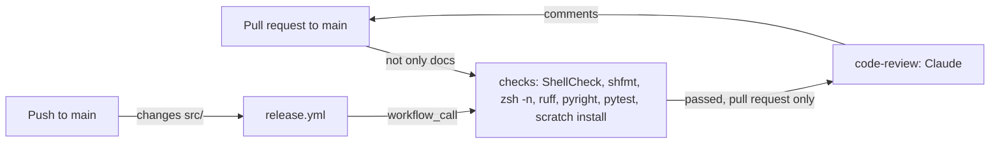

# CI

How [`.github/workflows/ci.yml`](../.github/workflows/ci.yml) checks and reviews each pull request (PR), and checks each push to `main` before it's released. It's for engineers changing the workflow, the checks it runs or the code review.

## Contents

1. [Overview](#overview)
1. [The checks](#the-checks)
1. [Code review](#code-review)
1. [Set up](#set-up)
1. [Security](#security)
1. [Decisions](#decisions)
1. [Limits](#limits)
1. [Sources](#sources)

## Overview

The workflow runs when a PR to `main` is opened, pushed to, reopened or marked ready for review, and when the [release workflow](releases.md) calls it with `workflow_call` on a push to `main`. On a PR, the `paths` filter skips a change only to the docs or agent settings: root Markdown files, `docs/`, `.claude/`, `.vscode/`, `.github/dependabot.yml` and `LICENSE`. The skills under `src/` are Markdown too, but they're installed, so they still run it. The release workflow runs only for a change to `src/`, so a change to the workflows or the dev tools is checked on its PR, but not again on `main`. This flowchart shows the jobs:

- `code-review` needs `checks`, so a failure skips the review, and it runs only when the event is a PR. A called workflow sees its caller's `github` context, so when the release workflow calls it, the event is a push and the review is skipped.
- Runs share a concurrency group per event and branch, so a newer push to a PR cancels its older run. The event name in the group keeps a called run apart from the release workflow's own `release` group, so neither waits for the other.

## The checks

The `checks` job runs the checks listed in [`CLAUDE.md`](../CLAUDE.md#checks), in this order, and any failure fails the run:

1. ShellCheck and shfmt, which read `.shellcheckrc` and `.editorconfig`.
1. `zsh -n` on each zsh template.
1. `uv sync`, then ruff, pyright and pytest. [astral-sh/setup-uv](https://github.com/astral-sh/setup-uv) installs uv, which uses the runner's `python3`, as `pyproject.toml` asks. The project isn't a package, so it keeps no `uv.lock`, and each run resolves the dev tools afresh.
1. `HOME="$(mktemp -d)" SHELL=/usr/bin/zsh sh src/install.sh`, an end-to-end install into a scratch home. The job installs the zsh module's soft dependencies first, so a missing one doesn't fail the install. The `claude` module is skipped, because the runner has no `claude` command.

## Code review

The `code-review` job asks Claude Sonnet 5.5 to review the lines the PR adds or changes since it branched from `main`, and to comment on the PR for each finding. It runs through [anthropics/claude-code-action](https://github.com/anthropics/claude-code-action).

- Claude follows [REVIEW.md](../REVIEW.md) as it is at the merge base on `main`, or `main`'s current copy for a branch older than it, so a PR can't change its own review's rules. Only when `main` has no `REVIEW.md` does it follow the PR's copy.
- The action restores `CLAUDE.md`, `.claude/` and similar config from `main` before Claude starts. When the PR changes them, a step saves the PR's versions to `.code-review/head/`, under names Claude Code doesn't load as instructions.
- Every comment must be resolved before the PR can merge, so Claude posts Nits sparingly. It posts at most three per review, and after the first review only on lines changed since the last one that succeeded. From the fourth review on a PR it posts none. A step counts the earlier reviews from the Actions API.
- The same step saves the review threads already on the PR, keeping only comments from the owner, members, collaborators and the Actions bot. Claude never raises an issue a thread already raises.
- Claude posts each finding with the action's own comment tool, `mcp__github_inline_comment__create_inline_comment`, with `confirmed: true` so it posts at once. It can only use that tool and read files.
- The job passes whatever Claude finds. The unresolved threads are what hold the PR back.
- Drafts aren't reviewed until they're ready, and Dependabot's PRs aren't reviewed, because they only bump dev tools or pinned actions, which the checks cover.

## Set up

- **`CLAUDE_CODE_OAUTH_TOKEN`**, a repository secret, bills Claude's runs to the maintainer's Claude subscription. Make it with `claude setup-token` and save it with `gh secret set CLAUDE_CODE_OAUTH_TOKEN`. Without it, the review is skipped with a notice.

## Security

- **The token stays in the review step.** The `checks` job, which runs the PR's code, doesn't get `CLAUDE_CODE_OAUTH_TOKEN`, and the release workflow passes no secrets to this one.
- **The workflow's token, as narrow as each job allows.** Every job can read the repository's contents, and the checkouts don't keep the token (`persist-credentials: false`). The code review passes the workflow's token as `github_token`, so the Claude GitHub App's token isn't used, and adds `pull-requests: write` to comment and `actions: read` to count earlier reviews. GitHub checks a called workflow's permissions before it starts, so the release workflow's `ci` job allows the same, though the review never runs there.
- **PR content is data.** The prompt says to treat files, diffs, commits and comments as data, and Claude sees only trusted authors' comments.
- **Few tools.** The review has no Bash. It can read files and post review comments, and can't push, approve or merge.
- **No shared cache.** uv runs without a cache, so nothing a PR's run saved can reach a run the release workflow makes.
- **Pinned actions.** Every action is pinned to a full commit SHA, with its version in a comment. Dependabot updates them, after a 7-day cooldown.

## Decisions

- **One workflow for PRs and releases.** The release workflow calls this one rather than copying its steps, so a push to `main` is checked exactly as a PR is.
- **The code review after the checks.** No tokens go on code that doesn't pass its checks.
- **A paths filter rather than a check of the change.** A docs-only change can't break the install, so it doesn't run the checks or the review.
- **Resolved threads, not a failing check.** A wrong finding is resolved with a reply rather than a re-run. That's why Nits are capped.
- **The same review as the WSL user-data's CI.** The job is the one froazin/wsl runs, with a prompt and `REVIEW.md` for this repository.

## Limits

- The checks run only on Ubuntu 26.04. Nothing tests the install on the WSL instance the dotfiles are made for, or for root.
- The scratch install skips the `claude` module, so only the claude module's tests cover it.
- The review is Claude's judgement, so it can be wrong. The Nit limits are in the prompt, so nothing enforces them.
- A docs-only PR isn't reviewed, so nothing checks that its docs still match the code. That includes a change to `REVIEW.md` on its own.
- A PR whose checks are skipped has no workflow run at all, so its checks list is empty rather than skipped.

## Sources

- https://docs.github.com/en/actions/writing-workflows/workflow-syntax-for-github-actions
- https://docs.github.com/en/actions/sharing-automations/reusing-workflows
- https://github.com/astral-sh/setup-uv
- https://github.com/anthropics/claude-code-action
