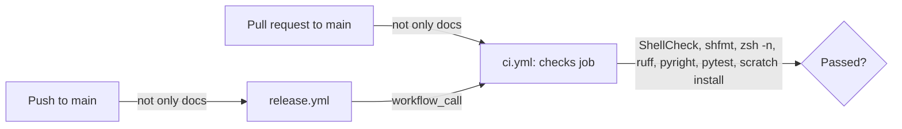

# CI

How [`.github/workflows/ci.yml`](../.github/workflows/ci.yml) checks each pull request, and each push to `main` before it's released. It's for engineers changing the workflow or the checks it runs.

## Contents

1. [Overview](#overview)
1. [The checks](#the-checks)
1. [Security](#security)
1. [Decisions](#decisions)
1. [Limits](#limits)
1. [Sources](#sources)

## Overview

The workflow runs on every pull request to `main`, and when the [release workflow](releases.md) calls it with `workflow_call` on a push to `main`. On a pull request, the `paths` filter skips a change only to the docs or agent settings: root Markdown files, `docs/`, `.claude/`, `.vscode/`, `.github/dependabot.yml` and `LICENSE`. The skills under `src/` are Markdown too, but they're installed, so they still run it. The release workflow has the same filter. This flowchart shows what starts it:

Runs share a concurrency group per event and branch, so a newer push to a pull request cancels its older run. A called workflow sees its caller's `github` context, so the event name in the group keeps a called run apart from the release workflow's own `release` group, and neither waits for the other.

## The checks

The `checks` job runs the checks listed in [`CLAUDE.md`](../CLAUDE.md#checks), in this order, and any failure fails the run:

1. ShellCheck and shfmt, which read `.shellcheckrc` and `.editorconfig`.
1. `zsh -n` on each zsh template.
1. `uv sync`, then ruff, pyright and pytest. [astral-sh/setup-uv](https://github.com/astral-sh/setup-uv) installs uv, which uses the runner's `python3`, as `pyproject.toml` asks. The project isn't a package, so it keeps no `uv.lock`, and each run resolves the dev tools afresh.
1. `HOME="$(mktemp -d)" SHELL=/usr/bin/zsh sh src/install.sh`, an end-to-end install into a scratch home. The job installs the zsh module's soft dependencies first, so a missing one doesn't fail the install. The `claude` module is skipped, because the runner has no `claude` command.

## Security

- The workflow's token can only read the repository, and the checkout doesn't keep it (`persist-credentials: false`), so the checks and the scratch install can't use it.
- uv runs without a cache, so nothing a pull request's run saved can reach a run the release workflow makes.
- Every action is pinned to a full commit SHA, with its version in a comment. Dependabot updates them.

## Decisions

- **One workflow for pull requests and releases.** The release workflow calls this one rather than copying its steps, so a push to `main` is checked exactly as a pull request is.
- **A paths filter rather than a check of the change.** A docs-only change can't break the install, so it doesn't run the checks.

## Limits

- The checks run only on Ubuntu 26.04. Nothing tests the install on the WSL instance the dotfiles are made for.
- The scratch install skips the `claude` module, so only the claude module's tests cover it.

## Sources

- https://docs.github.com/en/actions/writing-workflows/workflow-syntax-for-github-actions
- https://docs.github.com/en/actions/sharing-automations/reusing-workflows
- https://github.com/astral-sh/setup-uv
