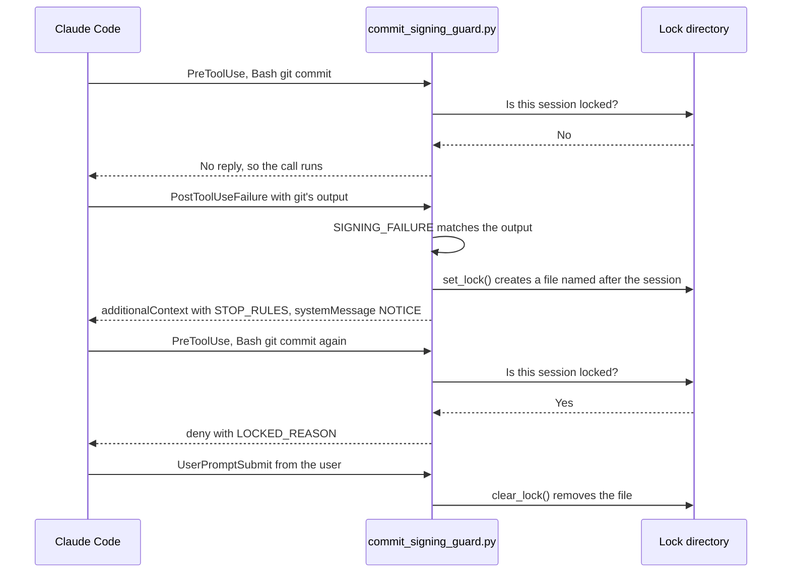

# Commit-signing guard

How the commit-signing guard hook stops Claude Code agents bypassing git commit signing, and makes them stop and report when signing fails. It's for engineers who change [`commit_signing_guard.py`](../../src/modules/claude/templates/hooks/commit_signing_guard.py), its wrapper or its rule.

## Contents

1. [Overview](#overview)
1. [How it works](#how-it-works)
1. [Interfaces](#interfaces)
1. [Errors and logging](#errors-and-logging)
1. [Security and privacy](#security-and-privacy)
1. [Decisions](#decisions)
1. [Limits](#limits)
1. [Tests](#tests)
1. [Sources](#sources)

## Overview

When signing needs the user in person, such as 1Password with Windows Hello, an agent working while the user is away hits a signing failure or a hang. It might then retry with signing switched off. The guard has two jobs:

- **Deny bypasses:** any tool call that would create an unsigned commit or tag, or change how git signs.
- **Stop after a failure:** when a git command fails to sign or hangs, tell the agent to stop and report, and deny every signing git command in that session until the user's next message.

The [`claude` module](overview.md) installs three files: the wrapper [`commit_signing_guard.sh`](../../src/modules/claude/templates/hooks/commit_signing_guard.sh), the Python logic beside it and the rule [`commit-signing.md`](../../src/modules/claude/templates/rules/commit-signing.md), which tells the agent the same policy in words. [`settings.json`](../../src/modules/claude/templates/settings.json) registers the wrapper (see [What the templates configure](overview.md#what-the-templates-configure)).

This sequence diagram shows a signing failure locking the session and the user's return unlocking it:

## How it works

`main` reads one event from stdin and passes it to `decide`, which branches on the event and tool:

| Event | Tools | What `decide` does |
| --- | --- | --- |
| `PreToolUse` | `Bash`, `Monitor` | Denies a bypass. Denies a signing command while locked, or in `Monitor` or a background `Bash` run (`ASYNC_REASON`) |
| `PreToolUse` | `Edit`, `Write`, `MultiEdit`, `NotebookEdit` | Denies edits of git config or the guard, and settings edits that turn the guard off (see `Guard.edit`) |
| `PostToolUse`, `PostToolUseFailure` | `Bash` | Looks for a signing failure or hang, and locks the session |
| `UserPromptSubmit` | any | Clears the lock, unless the prompt didn't come from the user |

### Reading commands

`lex` splits a command like a shell would: quotes, `$'...'`, heredocs, `$(...)`, backticks, `<(...)`, operators and redirects. Quoting is removed, so `-m "skip --no-gpg-sign here"` is one message word, not a flag. A message that's exactly a bypass flag, such as `-m "--no-gpg-sign"`, is still denied (observed). `Guard.script` then walks each simple command with a `State` per subshell level that tracks `cd`, variable assignments, `export`, `unset` and git aliases set earlier in the script.

`Guard.command` looks through what runs the real command, up to `MAX_DEPTH` (8) levels deep:

- `sudo`, `doas` and `pkexec` (marked privileged), `env` and the wrappers in `WRAPPERS`, such as `timeout`, `nohup` and `flock`.
- `sh -c`, `bash -c` and the other `SHELLS`, `eval`, `watch`, `script -c`, `su -c`, `runuser -c`, `find -exec` and `xargs`.
- A script fed to a shell, `source` or `.` by a heredoc, a here-string, or the output of `echo`, `printf` or `cat` through a pipe or `<(...)`. A script file on disk isn't read.
- `$(which git)`, `/usr/lib/git-core/git-commit` and git aliases, including `!` shell aliases. An alias it doesn't know is read with `git config --get alias.<name>`.

### Bypasses

`Guard.command`, `Guard.git`, `Guard.git_config`, `Guard.file_command` and `Guard.edit` add a reason to `bypasses`. The first one goes into the deny message from `bypass_reason`. They deny:

- `--no-gpg-sign` (or any prefix of it down to `--no-g`) on any subcommand, and `git tag --no-sign`.
- `-c` and `--config-env` overrides of the signing keys (`commit.gpgsign` and `tag.gpgsign` unless set to true, the keys in `SIGNING_KEYS` such as `gpg.format`, `gpg.program` and `user.signingkey`, `include.path` and `includeIf.*`) and aliases whose definition mentions signing settings or the bypass flags, or can't be known. Read-only subcommands in `READ_ONLY_GIT` may override signing keys, so `git log --show-signature` can use another verifier.
- `git clone -c` with a signing key, any `git config --edit`, and a `git config` set, unset, `--remove-section` or `--rename-section` of signing keys or sections. A `--file` inside the working tree but outside `.git` is allowed.
- `HOME` overrides, `sudo` and other privileged runs and `GIT_CONFIG_*` variables, on a signing command.
- Unsigned plumbing: `commit-tree` without `-S`, `hash-object -t commit` or `tag`, `mktag`, `fast-import`, `filter-branch`, `filter-repo`, `replay` and `stash create` or `store`.
- Shell writes (redirects, `tee`, `cp`, `mv`, `sed -i`, editors and others) to `~/.gitconfig`, `$XDG_CONFIG_HOME/git/config`, a repository's `.git/config`, the guard's files, its lock directories, the user's `settings.json` in the config directory or the project's `.claude/settings.json` or `.claude/settings.local.json`. `rm`, `mv`, `chmod` and the others in `DESTRUCTIVE` are also denied on the whole config directory, its `hooks` or `state` directory or `$XDG_RUNTIME_DIR`.
- `Edit`, `Write`, `MultiEdit` and `NotebookEdit` calls on the global git config, on the guard's files or lock directories or on a repository's git config when they touch signing, `include` or `[alias]` settings (any `Write` of it counts).
- Edits that set `"disableAllHooks": true` in a settings file or that remove `commit_signing_guard` from the user's `settings.json`.
- An unresolved command (`$GIT ...`) with a signing flag.

### Signing commands

`Guard.git_signs` decides whether a command signs. `commit`, `merge`, `rebase`, `cherry-pick`, `revert`, `am`, `pull` and `commit-tree` sign, unless they run with `--abort`, `--quit`, `--show-current-patch` or `--edit-todo`. `git tag` signs when it names a tag and isn't listing, deleting or verifying. `git push --signed` signs.

### Failures and hangs

After a `Bash` call, the guard joins the event's `error`, the response's `stdout` and `stderr`, and the response itself when it's a string:

- **Failure:** a signing command ran, or the tool call failed, and the output has a line matching `SIGNING_FAILURE` (git's `error:` or `fatal:` lines from 1Password, `op-ssh-sign`, an SSH agent or gpg) but not `NOT_SIGNING` (permission or disk errors). The guard locks the session.
- **Hang:** a signing command ran and the call timed out (`timedOutAfterMs`, `Command timed out after` or exit 124 under `timeout`). If the output shows a new commit, nothing happens. If every top-level command before the last signing one was quick (such as one in `QUICK_COMMANDS`, a git command outside `SLOW_GIT` or another signing command) and something other than `pull` was signing, the guard locks the session and says not to kill the command. Otherwise it only warns (`MAYBE_HANG_CONTEXT`), since the slow part may have been something else, such as `npm test`.

### The session lock

- The lock is an empty file named after the event's `session_id` (letters, digits, `_` and `-` only, or `unknown`), in `$XDG_RUNTIME_DIR/claude-commit-signing/` when that directory is the user's own and writable, or in `<config dir>/state/claude-commit-signing/` if not.
- `set_lock` creates the directory with mode `0700` and checks it's a real directory the user owns, then creates the file with mode `0600` and `O_NOFOLLOW`.
- `UserPromptSubmit` clears it, unless the event's `source` is set to something other than `user` or `sdk`, or the prompt starts with a tag in `SYSTEM_PROMPT`, such as `<task-notification>` or `<teammate-message>`. Background results, scheduled prompts and other sessions' messages arrive as prompts, but they aren't the user coming back.
- If the lock can't be written, the agent is told so (`UNLOCKED_NOTE`) and to stop signing itself.

## Interfaces

- **Input:** one JSON event on stdin. The guard reads `hook_event_name`, `tool_name`, `tool_input`, `cwd`, `session_id`, `tool_response`, `error`, `source` and `prompt`. Anything that isn't a JSON object decides nothing.
- **Deny:** `hookSpecificOutput` with `permissionDecision: "deny"` and a `permissionDecisionReason` that tells the agent not to work around it.
- **Context:** after a failure or hang, `hookSpecificOutput.additionalContext` carries the instructions for the agent, and `systemMessage` carries `NOTICE` for the user.
- **No output** means no decision: Claude Code carries on as normal.

## Errors and logging

- The guard writes nothing but its JSON reply. It doesn't log.
- `main` catches every exception and prints nothing, so a bug fails open rather than breaking Claude Code.
- The wrapper exits 0 when `python3` is missing, so the guard does nothing. The module logs that as an error at install time.
- The alias lookup runs `git config` with a 2-second timeout and treats any error as no alias.

## Security and privacy

- The guard is a guard rail against an agent's habits, not a security boundary.
- It protects itself: changes to its files, its lock directories and the settings that run it are bypasses.
- The lock never lives in a shared `/tmp`, where another user could plant the directory or a symbolic link.
- The wrapper runs `python3 -I`, so nothing on `PYTHONPATH` or next to the script can shadow the standard library.
- It reads only the event, the user's git aliases, the lock directory and, for a `Write` of the user's `settings.json`, that file. It sends nothing anywhere.

## Decisions

- **Lex the shell instead of matching text**, so commit messages that mention the flags are allowed and wrapped commands are still seen.
- **No opt-out.** The user can commit unsigned by running the command themselves.
- **Lock until the user's next message**, not for a fixed time: a failure means the user is away, and only their return changes that.
- **Deny signing in the background and in `Monitor`**, so a signing failure is always seen by the post hooks.
- **Fail open**: a broken guard must never break Claude Code.
- **Standard library only**, so it runs on the system `python3` without installing anything.

## Limits

- A script on disk, another interpreter or another git client can still get past it.
- Nesting deeper than 8 levels isn't inspected.
- Variables whose values it can't know are treated as unknown, so some overrides through them go unseen (inferred).
- Failure detection matches known messages from 1Password, `op-ssh-sign`, SSH agents and gpg. Another signer's wording may not match (inferred).
- The fallback lock directory under the config directory isn't cleared at logout, unlike `$XDG_RUNTIME_DIR` (inferred).
- Whether subagents share the parent's `session_id`, and so its lock, isn't tested here.

## Tests

The command cases are in [`commit_signing_guard.cases`](../../src/modules/claude/tests/commit_signing_guard.cases), one per line as `deny`, `allow`, `locked-deny`, `locked-allow`, `lock` or `none`. [`test_commit_signing_guard.py`](../../src/modules/claude/tests/test_commit_signing_guard.py) runs them and covers the edit tools, timeouts, background runs, the lock lifecycle and the wrapper. Add a case for every fix.

## Sources

- https://code.claude.com/docs/en/hooks
