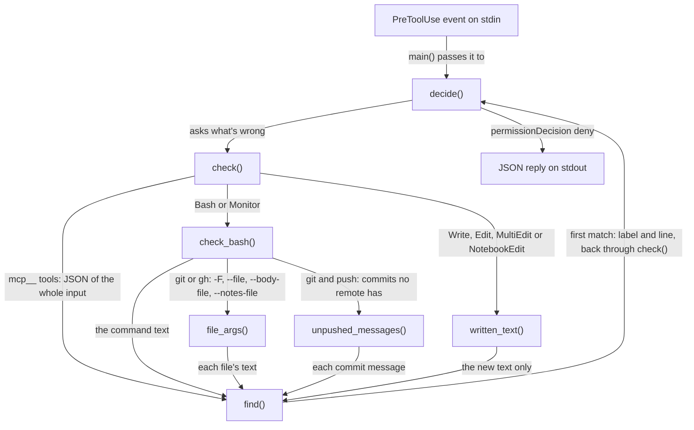

# No-session-links hook

How the no-session-links hook keeps links to Claude Code sessions, `Claude-Session:` trailers and `claude.ai` artifact links out of commits, pull requests, files and MCP calls. It's for engineers who change [`no_session_links.py`](../../src/modules/claude/templates/hooks/no_session_links.py), its wrapper or its rule.

## Contents

1. [Overview](#overview)
1. [How it works](#how-it-works)
1. [Interfaces](#interfaces)
1. [Errors and logging](#errors-and-logging)
1. [Security and privacy](#security-and-privacy)
1. [Decisions](#decisions)
1. [Limits](#limits)
1. [Tests](#tests)
1. [Sources](#sources)

## Overview

Claude Code can add a link to its session (`claude.ai/code/session_...`) to commit messages and pull requests. In a public repository anyone can follow it, and a commit message stays in the history after it's fixed. The [`claude` module](overview.md) closes this in three layers:

- **Settings:** [`settings.json`](../../src/modules/claude/templates/settings.json) sets `attribution.sessionUrl` to `false`, so Claude Code doesn't add the link itself, and `attribution.pr` to `""`, so pull request descriptions get no "Generated with Claude Code" line.
- **Rule:** [`no-session-links.md`](../../src/modules/claude/templates/rules/no-session-links.md) tells the agent never to add a link, what to do when the hook blocks one and how to fix one that got through.
- **Hook:** [`no_session_links.sh`](../../src/modules/claude/templates/hooks/no_session_links.sh) runs the Python logic on every `PreToolUse` event that matches `Bash|Monitor|Edit|Write|MultiEdit|NotebookEdit|mcp__.*`, and denies a call that would publish a link another way.

The hook doesn't deny the `Co-Authored-By:` footer, which the rule says to keep.

## How it works

This flowchart shows what `check` scans for each kind of tool:

### Patterns

`find` tries the patterns in `PATTERNS` in order and reports the first match, with the line it's on, trimmed to 120 characters:

| Label | Matches |
| --- | --- |
| A Claude Code session URL | `claude\.ai/code/session_` followed by a letter or digit |
| A claude.ai artifact link | `claude\.ai/artifact/` or `claude\.ai/code/artifact/` followed by a letter or digit |
| A Claude-Session trailer | A line that starts with optional spaces or tabs, then `Claude-Session:` and a value (case-insensitive) |
| A Claude Code session ID | `session_` and 24 or more letters or digits, as a whole word |

Prose that mentions them is fine: `claude.ai/code/session_...`, `Claude-Session:` in the middle of a line and a short `session_` value don't match.

### Bash and Monitor

`check_bash` stops at the first hit:

1. It scans the whole command, which includes any heredoc, so `git commit -F - <<'EOF'` is covered.
1. If `git` or `gh` is one of its words (split with `shlex`), `file_args` reads each file named after `-F`, `--file`, `--body-file` or `--notes-file`, in either `--flag value` or `--flag=value` form. A relative path is resolved against the directory from `git -C`, or the event's `cwd`. It skips `-`, any value with `=` in it (`gh api -F` takes `key=value` fields) and files over 1,000,000 bytes.
1. If both `git` and `push` are words in the command, `unpushed_messages` runs `git log HEAD --not --remotes` in that directory, with a 5-second timeout, and scans each commit message. The deny names the commit and says to reword it before pushing.

### Write tools and MCP tools

- `written_text` takes `content` from `Write`, `new_string` from `Edit`, `new_source` from `NotebookEdit` and every `new_string` from `MultiEdit`. Old text isn't checked, so removing a link is allowed.
- For any tool whose name starts with `mcp__`, the hook scans the whole `tool_input` as JSON (`ensure_ascii=False`), so a link nested anywhere in it counts.
- Other tools, such as `Read`, are never denied.

## Interfaces

- **Input:** one JSON event on stdin. The hook reads `hook_event_name`, `tool_name`, `tool_input` and `cwd`. It acts only when `hook_event_name` is `PreToolUse` or missing, and anything that isn't a JSON object decides nothing.
- **Deny:** `hookSpecificOutput` with `permissionDecision: "deny"`. The `permissionDecisionReason` starts with "Blocked by the no-session-links hook" and says what it found and on which line. It then tells the agent to remove the link, keep the `Co-Authored-By` footer and not work around the hook.
- **No output** means no decision: Claude Code carries on as normal.

## Errors and logging

- The hook writes nothing but its JSON reply. It doesn't log.
- `main` catches every exception and prints nothing, so a bug fails open. That includes a `git log` that takes longer than 5 seconds (inferred from the code: `subprocess.run` raises on a timeout).
- A message file it can't read is skipped, and `git log` failing (outside a repository, for example) means no commits to check.
- The wrapper exits 0 when `python3` is missing, so the hook does nothing. The module logs that as an error at install time.

## Security and privacy

- It's a guard rail against Claude Code's attribution habits, not a security boundary.
- The deny reason quotes the line with the link, which goes back to the agent that wrote it.
- It reads only the event, the message files the command names and the local commit log, and sends nothing anywhere.
- The wrapper runs `python3 -I`, so nothing on `PYTHONPATH` or next to the script can shadow the standard library.

## Decisions

- **Settings first, hook second.** `attribution.sessionUrl: false` stops Claude Code adding the link itself. The hook catches a link that arrives any other way, such as text an agent writes into a file, a message file or an MCP call.
- **Keep the `Co-Authored-By:` footer.** Pull requests credit Claude with the same footer as commits, which is why `attribution.pr` is `""` rather than a custom line.
- **Check unpushed commits on push.** A link already committed is still fixable until it's pushed. Once a remote has the commit, rewording it is the user's call, so the hook lets the push through.
- **Plain `shlex` splitting.** The hook scans the raw command text for links, and only needs words to find `git`, `gh`, `push` and the file flags, so it doesn't use the [commit-signing guard](commit-signing-guard.md)'s shell lexer (inferred: the code doesn't say why).
- **Fail open**: a broken hook must never break Claude Code.

## Limits

- A link built at run time, such as one split across variables or written by a script, isn't seen. The rule tells the agent never to do that.
- The push check reads the commits on `HEAD`, not the branch being pushed, so `git push origin <other-branch>` checks the wrong commits (inferred from the code).
- File flags are read for any `git` or `gh` command, so an `-F` that isn't a message file but names a readable file is scanned too (inferred).
- An unrelated identifier of `session_` and 24 or more letters or digits is denied as a session ID (inferred).
- The hook doesn't protect itself. The commit-signing guard denies shell writes to the user's `settings.json`, `"disableAllHooks": true` and removing the whole `hooks` directory, but an `Edit` that removes this hook's entry from `settings.json`, an `Edit` of `no_session_links.py` and an `rm` of it are allowed (observed).

## Tests

[`test_no_session_links.py`](../../src/modules/claude/tests/test_no_session_links.py) covers commands, message files, the push check in a scratch repository, every tool type, the deny reason, broken input, the wrapper and the `attribution` settings. It builds its fixture links from parts, or the installed hook would block writing the file. Add a case for every fix.

## Sources

- https://code.claude.com/docs/en/hooks
- https://code.claude.com/docs/en/settings
