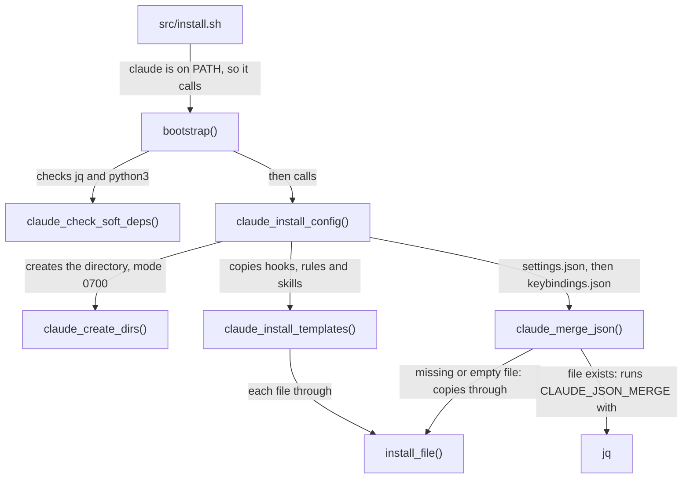

# Claude module

How the `claude` module installs Claude Code's user configuration, how it merges `settings.json` and `keybindings.json` into what's already there and how its tests run. It's for engineers who change [`src/modules/claude/`](../../src/modules/claude/).

## Contents

1. [Overview](#overview)
1. [Layout](#layout)
1. [How it works](#how-it-works)
1. [What the templates configure](#what-the-templates-configure)
1. [Errors and logging](#errors-and-logging)
1. [Security and privacy](#security-and-privacy)
1. [Tests](#tests)
1. [Decisions](#decisions)
1. [Limits](#limits)
1. [Sources](#sources)

## Overview

The module writes the Claude Code configuration directory: `$CLAUDE_CONFIG_DIR` when it's set, otherwise `~/.claude`. It installs three hooks, the rules that go with them and the ways of working skills, and merges in shared settings and keybindings. It doesn't install Claude Code itself: the WSL user-data does that (see [WSL provisioning](https://github.com/froazin/wsl/blob/main/docs/provisioning.md)).

[`src/install.sh`](../../src/install.sh) runs the module only when `claude` is on `PATH` (see [Installer](../installer.md)). Each hook has its own design doc:

- [Commit-signing guard](commit-signing-guard.md): stops agents bypassing commit signing, and makes them stop when signing fails.
- [No-session-links hook](no-session-links.md): keeps Claude Code session links out of commits, pull requests and files.
- [Ways of working](ways-of-working.md): turns the `wow-core` rule and the `wow-*` skills on for directories with a `.wow` marker.

## Layout

```text
src/modules/claude/
├── bootstrap.sh                 bootstrap() and the jq merge program
├── templates/                   installed as the config directory
│   ├── settings.json            merged, never copied over
│   ├── keybindings.json         merged, never copied over
│   ├── hooks/                   commit_signing_guard.{sh,py}, no_session_links.{sh,py}, wow_marker.sh
│   ├── rules/                   commit-signing.md, no-session-links.md, wow-core.md
│   └── skills/                  wow-*/SKILL.md, and references/ for the longer ones
└── tests/                       pytest tests for the hooks and the ways of working content
```

The templates sit directly in `templates/`, not in `templates/.claude/`, because pyright skips any path with a dot-directory in it.

## How it works

This flowchart shows the functions in [`bootstrap.sh`](../../src/modules/claude/bootstrap.sh) and what each one passes on:



### Directories and templates

- `claude_create_dirs` creates the config directory, sets it to mode `0700` and creates `agents`, `commands`, `skills`, `rules`, `output-styles` and `hooks` in it (`CLAUDE_SUBDIRS`).
- `claude_install_templates` lists every file under `templates/` with `find`, leaving out `settings.json`, `keybindings.json`, `__pycache__/` and `*.pyc`. It copies each one with `install_file` from [`common.sh`](../../src/internal/common.sh), which overwrites a changed file, skips an identical one and leaves a symbolic link alone.
- A template that's executable in the repository is set to mode `755` once it's copied. That's how the `.sh` hooks stay runnable.
- Templates are copied, not linked, so a change in the repository takes effect when the installer runs again.

### Merging settings and keybindings

`claude_merge_json` handles each JSON file in this order:

1. A symbolic link at the destination is left alone, with a warning.
1. A missing or empty file is created from the template with `install_file`.
1. A read-only file is left alone, with a warning. Without `jq`, an existing file is left unchanged and the module logs an error.
1. Otherwise it copies the file with `cp -p` to `<file>.dotfiles.<pid>`, so the result keeps the original's mode, and runs `jq -n --slurpfile cur <file> --slurpfile tpl <template>` with the program in `CLAUDE_JSON_MERGE`.
1. If the output matches the file byte for byte, it's discarded. If not, `mv -f` puts it in place.

`CLAUDE_JSON_MERGE` applies these rules:

| Value | Result |
| --- | --- |
| Object in both | Merged key by key, recursively. Keys only in the existing file stay |
| Array in both | The existing array, then any template items it doesn't already hold |
| Anything else | The template's value wins |
| A hook under `hooks.<event>` | Existing hooks with the same `command` as a template hook are removed, and an entry left with no hooks is dropped. The template's entries are then appended |
| `bindings` (keybindings) | Merged by `context` with `merge_by`: each template block merges into the first existing block with the same `context`, or is appended |
| Whitespace-only file | Replaced with the template |
| Invalid JSON, or anything but one JSON object | `jq` fails (with `not a single JSON object` for a valid file that isn't one object), and the file is left unchanged |

Observed in a throwaway home: an existing `"model"` was replaced by the template's, an existing `permissions.allow` entry and a user's own hook command were kept, an old copy of the guard hook with a different `timeout` was replaced and an existing `Chat` keybindings block gained the template's keys without a second `Chat` block. A second run reported the files as already up to date.

## What the templates configure

[`settings.json`](../../src/modules/claude/templates/settings.json) sets:

- `env.CLAUDE_CODE_ADDITIONAL_DIRECTORIES_CLAUDE_MD` to `"1"`, so Claude Code loads `CLAUDE.md` from directories added with `--add-dir`.
- `permissions.deny` for `Read` of `*.env`, `*.env.*`, `*.pem`, `*.crt`, `*.key` and `~/.ssh/**`.
- `attribution.sessionUrl` to `false` and `attribution.pr` to `""` (see [No-session-links hook](no-session-links.md#decisions)).
- `model`, `theme`, `modelSettings` and the two notification settings.
- The hooks, each with a `timeout` of 10 seconds:

| Event | Matcher | Hook |
| --- | --- | --- |
| `PreToolUse` | `Bash\|Monitor\|Edit\|Write\|MultiEdit\|NotebookEdit` | `commit_signing_guard.sh` |
| `PreToolUse` | `Bash\|Monitor\|Edit\|Write\|MultiEdit\|NotebookEdit\|mcp__.*` | `no_session_links.sh` |
| `PreToolUse` | `Read\|Edit\|Write\|MultiEdit\|NotebookEdit\|Glob\|Grep\|Bash\|Monitor` | `wow_marker.sh pre-tool` |
| `PreToolUse` | `Skill` | `wow_marker.sh pre-skill` |
| `PostToolUse` | `Bash` | `commit_signing_guard.sh` |
| `PostToolUse` | `Bash` | `wow_marker.sh post-bash` |
| `PostToolUseFailure` | `Bash` | `commit_signing_guard.sh` |
| `UserPromptSubmit` | none | `commit_signing_guard.sh` |
| `SessionStart` | none | `wow_marker.sh session-start` |
| `SubagentStart` | none | `wow_marker.sh subagent-start` |
| `UserPromptExpansion` | none | `wow_marker.sh expand` |
| `SessionEnd` | none | `wow_marker.sh session-end` |

Each hook's `command` is `"${CLAUDE_CONFIG_DIR:-$HOME/.claude}"/hooks/<name>.sh`, plus a mode argument for `wow_marker.sh`. It finds the hook wherever the config directory is.

[`keybindings.json`](../../src/modules/claude/templates/keybindings.json) binds, in the `Chat` context, <kbd>Enter</kbd> to `chat:newline` and <kbd>Ctrl</kbd>+<kbd>Enter</kbd> and <kbd>Shift</kbd>+<kbd>Enter</kbd> to `chat:submit`.

The files in [`rules/`](../../src/modules/claude/templates/rules/) have no `paths` frontmatter, so Claude Code loads them in every session: `commit-signing.md`, `no-session-links.md` and `wow-core.md`. The eleven `wow-*` skills in [`skills/`](../../src/modules/claude/templates/skills/) load on demand, and only apply where a `.wow` marker turns the ways of working on (see [Ways of working](ways-of-working.md)).

## Errors and logging

The module logs with `log` from [`logging.sh`](../../src/internal/logging.sh) and follows the installer's dependency grading:

- `claude_check_soft_deps` logs an error for a missing `jq` or `python3`, and `bootstrap` returns 1, but the configuration is still installed. Without `python3`, both Python hooks are installed and do nothing. `wow_marker.sh` needs only `sh` and basic utilities, so it works without either.
- Each step sets a failure flag rather than stopping, so one failed file doesn't stop the rest.
- A `jq` error is reduced to its first line, with `"` and `\` removed, so it fits in the JSON log line.
- A failed merge removes its temporary file and leaves the destination unchanged.

## Security and privacy

- The config directory is mode `0700`, because Claude Code keeps credentials and session history there in plain text (per the comment in `claude_create_dirs`).
- The `permissions.deny` rules keep common secret files out of Claude's `Read` tool. They don't stop a shell command from reading them.
- The Python hooks' wrappers run `python3 -I`, so a module next to the hook or on `PYTHONPATH` can't shadow the standard library. Those hooks use the standard library only.
- `wow_marker.sh` never puts an absolute path in Claude's context (see [Ways of working](ways-of-working.md#security-and-privacy)).
- The templates hold no identifying data, and the module never reads any.

## Tests

The tests are in [`src/modules/claude/tests/`](../../src/modules/claude/tests/). Run them from the repository root:

```sh
uv run pytest
```

- [`pyproject.toml`](../../pyproject.toml) puts `src/modules/claude/templates/hooks` on the import path, so the tests import the hooks as modules. [`pyrightconfig.json`](../../pyrightconfig.json) does the same for type checking.
- [`conftest.py`](../../src/modules/claude/tests/conftest.py) turns off bytecode writing, so no `__pycache__` appears in `templates/hooks/`.
- [`test_commit_signing_guard.py`](../../src/modules/claude/tests/test_commit_signing_guard.py) runs the one-line cases in [`commit_signing_guard.cases`](../../src/modules/claude/tests/commit_signing_guard.cases), whose header explains the format, plus structural tests.
- [`test_no_session_links.py`](../../src/modules/claude/tests/test_no_session_links.py) builds its fixture links from parts, so the installed hook doesn't block writing the file. It also checks the `attribution` settings and that every `PreToolUse` hook's script is executable, ignoring any mode argument.
- [`test_wow_marker.py`](../../src/modules/claude/tests/test_wow_marker.py) runs `wow_marker.sh` in a throwaway home, and [`test_wow_content.py`](../../src/modules/claude/tests/test_wow_content.py) checks the `wow-*` rule and skills (see [Ways of working](ways-of-working.md#tests)).
- Observed: 621 tests passed on this branch.

## Decisions

- **Merge, don't overwrite.** Claude Code writes `settings.json` itself (`/model`, `/config`, `/permissions`, plugins), and users edit `keybindings.json`. Merging keeps their keys while the template's values win.
- **Replace hooks by command.** A plain array union would keep an outdated copy of a template hook next to the new one. Each hook runs through a `.sh` wrapper so its command stays the same (per the comment in each wrapper), and the merge can find and replace it.
- **Merge keybindings by context.** A union would add a second block for a context whenever the template's block changed.
- **Slurp each file on its own** with its own `--slurpfile`, so one file's contents can never shift the other's (per the comment on `CLAUDE_JSON_MERGE`).
- **Python behind a shell wrapper.** The wrapper exits 0 without `python3`, which Claude Code treats as no decision, so a missing interpreter never blocks a tool. `wow_marker.sh` is plain `sh` instead, because it runs on almost every tool call (see [Ways of working](ways-of-working.md#decisions)).

## Limits

- Without `jq`, an existing file is never updated, so new template settings don't reach it.
- A symbolic link at `settings.json`, `keybindings.json` or a template's destination is left alone and counts as a failure.
- The merge never removes a key the template stops setting. Removing one means editing the user's file.
- Template values win on every run, so a user's change to a key the template sets, such as `model`, is undone by the next install.
- Only `bindings` merges by key, and only hooks are replaced by `command`. Other arrays of objects are unioned whole, so an object that differs in any field is added next to the old one.

## Sources

- https://code.claude.com/docs/en/settings
- https://code.claude.com/docs/en/hooks
- https://code.claude.com/docs/en/keybindings
- https://code.claude.com/docs/en/memory
