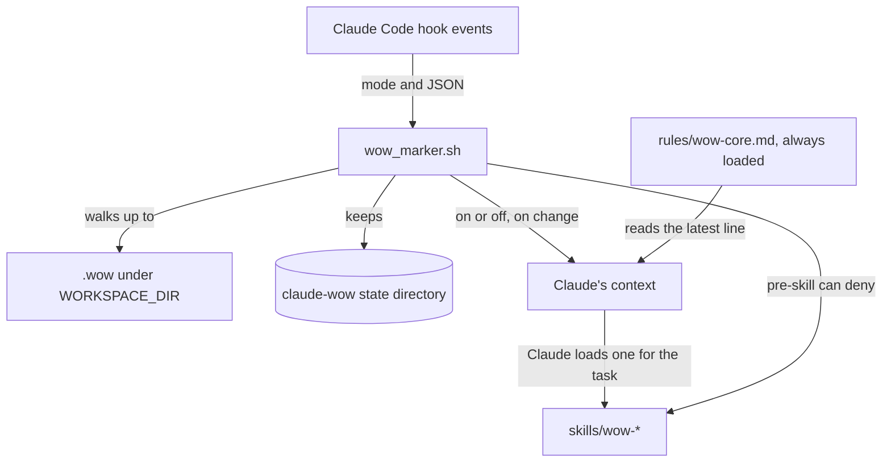
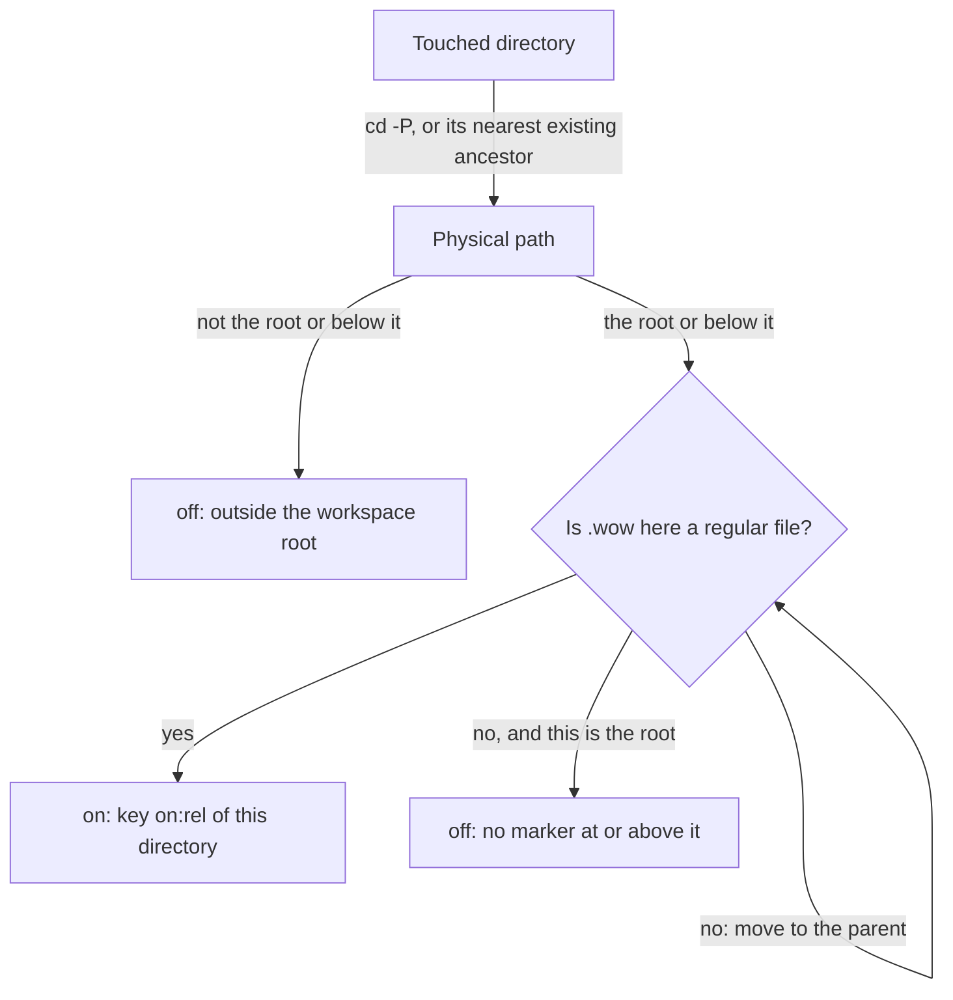

# Ways of working

How the `.wow` marker turns the `claude` module's ways of working on for a directory: the [`wow_marker.sh`](../../src/modules/claude/templates/hooks/wow_marker.sh) hook, the always-loaded [`wow-core.md`](../../src/modules/claude/templates/rules/wow-core.md) rule and the `wow-*` skills. It's for engineers who change any of them.

## Contents

1. [Overview](#overview)
1. [How it works](#how-it-works)
1. [Interfaces](#interfaces)
1. [Content](#content)
1. [Errors and logging](#errors-and-logging)
1. [Security and privacy](#security-and-privacy)
1. [Decisions](#decisions)
1. [Limits](#limits)
1. [Tests](#tests)
1. [Sources](#sources)

## Overview

The ways of working are house defaults for contributing and writing: commit messages, pull requests, branching, versioning, docs, Markdown, diagrams and GitHub wikis. The module installs them everywhere, but they apply only where the user opts in. A `.wow` file turns them on for the directory that holds it and everything below it, inside the workspace root `${WORKSPACE_DIR:-${SUDO_HOME:-$HOME}/workspaces}`. Only the file's presence counts: its contents are never read.

- **Hook:** `wow_marker.sh` finds the marker for each directory Claude works in and tells Claude when the state changes. It also denies a `wow-*` skill when nothing touched in the session is marked.
- **Rule:** `wow-core.md` loads in every session. It says how to read the hook's lines, which guidance wins and which skill to load for each task.
- **Skills:** eleven skills in [`templates/skills/`](../../src/modules/claude/templates/skills/), loaded on demand.

The zsh module exports `WORKSPACE_DIR` (see [zsh module](../zsh/overview.md#how-it-loads)), and the git module ignores `**/.wow` in every repository (see [git module](../git-module.md)). This flowchart shows how the parts fit together:

## How it works

### Finding the marker

`wow_find` works out the state for one directory. A relative directory is relative to the hook's working directory, which is Claude's current directory. The root is resolved with `cd -P` too, and a root that doesn't exist means every path is off.

- A directory that doesn't exist yet, such as one a `Write` creates, counts as its nearest existing ancestor. So does a path that names a file.
- The walk doesn't stop at `.git`, so a submodule or a monorepo package inherits the marker above it. A `.wow` directory doesn't count, and nor does a marker above the root.
- The state key is `on:<rel>`, where `<rel>` is the marker's directory relative to the root (empty for the root itself), or `off`.

### Which directory a tool touches

| Mode | Directory |
| --- | --- |
| `pre-tool` for `Read`, `Edit`, `Write`, `MultiEdit` | The directory part of `file_path` |
| `pre-tool` for `NotebookEdit` | The directory part of `notebook_path` |
| `pre-tool` for `Glob` and `Grep` | `path`, relative to Claude's current directory, or that directory when `path` is missing |
| `pre-tool` for `Bash` and `Monitor`, and `post-bash` | Claude's current directory (`post-bash` catches a `cd`) |
| `session-start`, `subagent-start` and `status` with no argument | Claude's current directory |

### Telling Claude only when it changes

Each session keeps its last state key in a file, and each subagent keeps its own. `pre-tool` and `post-bash` compare the new key with the stored one and print a line only when it differs. `session-start` clears the session's files and records the key for the current directory, so every start, resume, clear, compact or fork begins again. It prints the line only when on, because no line already means off.

- When the key is unchanged, the hook reads the state file and exits without a lock. That's the usual case, at one `sed` process per call (observed: about 3.5 ms).
- To change the key, it takes a lock by creating `<sid>.lock` with `mkdir`, retrying 20 times 0.05 seconds apart. It reads the key again under the lock, so two parallel tool calls announce a change once. If it can't take the lock, it announces anyway and removes the lock, taking it for one a killed hook left behind.
- Any touched directory that's on sets the session's on-flag, from the main agent or a subagent. Only `session-start` and `session-end` clear it.

### The skill gate

`pre-skill` checks the `skill` name, without a leading `/`. A name that matches `wow-*` or `<plugin>:wow-*` is allowed when the on-flag is set or Claude's current directory is on. Otherwise it exits 2, which blocks the call and shows the deny message to Claude. `expand` applies the same test to a command the user typed, such as `/wow-commits`, but never blocks it: it adds a note that the ways of working are off here.

## Interfaces

Each registration in [`settings.json`](../../src/modules/claude/templates/settings.json) runs `"${CLAUDE_CONFIG_DIR:-$HOME/.claude}"/hooks/wow_marker.sh <mode>` with a `timeout` of 10 seconds:

| Mode | Event and matcher | Prints | Exit |
| --- | --- | --- | --- |
| `session-start` | `SessionStart`, no matcher | The line as plain text, only when on | 0 |
| `subagent-start` | `SubagentStart`, no matcher | `SubagentStart` JSON, only when on | 0 |
| `pre-tool` | `PreToolUse`, `Read\|Edit\|Write\|MultiEdit\|NotebookEdit\|Glob\|Grep\|Bash\|Monitor` | `PreToolUse` JSON when the key changes | 0 |
| `post-bash` | `PostToolUse`, `Bash` | `PostToolUse` JSON when the key changes | 0 |
| `pre-skill` | `PreToolUse`, `Skill` | The deny message on stderr | 2 to deny, otherwise 0 |
| `expand` | `UserPromptExpansion`, no matcher | `UserPromptExpansion` JSON when a typed `wow-*` command is off | 0 |
| `session-end` | `SessionEnd`, no matcher | Nothing | 0 |
| `status [dir]` | None: for people and tests | The line for `dir`, default the current directory | 0 on, 1 off |

The JSON is `{"hookSpecificOutput":{"hookEventName":"<event>","additionalContext":"<line>"}}`. It never holds a `permissionDecision`. `status` never touches the state, and an unknown mode does nothing.

### Context lines

The `Ways of working: on` and `Ways of working: off` prefixes are a contract with `wow-core.md` and both test files. `<workspaces>` stands for the root:

- `Ways of working: on for <workspaces>/<rel> (marker <workspaces>/<rel>/.wow).`, or `on for <workspaces> (marker <workspaces>/.wow).` for a marker at the root.
- `Ways of working: off for <workspaces>/<rel> (no .wow marker at or above it).`, where `<rel>` is the touched directory, or `off for <workspaces> (no .wow marker at or above it).` for the root itself.
- `Ways of working: off (outside <workspaces>).`
- When `<rel>` holds a character outside `[A-Za-z0-9._/@+-]`, the path is left out: `Ways of working: on (marker found).` or `Ways of working: off (no .wow marker at or above this directory).`
- `pre-skill` denies with `Ways of working is off: no directory touched in this session has a .wow marker, so wow-* skills don't apply.`
- `expand` adds `Ways of working: off here (no .wow marker). The user typed /<name> explicitly.`, or `The user typed the command explicitly.` when the name holds an unsafe character.

### Input

`wow_read_input` runs one `sed` over the event JSON in the C locale, so an invalid UTF-8 byte can't hide a later key, and keeps `session_id`, `agent_id`, `file_path`, `notebook_path`, `path`, `skill` and `command_name` (it extracts `source` too, but nothing uses it). It folds newlines first, so pretty-printed JSON works and a value can't inject a line. The first occurrence of each key wins. A value with a `"` or `\` in it, which JSON would escape, counts as absent.

### State files

The state directory is `$XDG_RUNTIME_DIR/claude-wow` when `XDG_RUNTIME_DIR` is a writable directory, otherwise `${XDG_CACHE_HOME:-$HOME/.cache}/claude-wow`. The hook creates it with mode `0700`.

| File | Holds |
| --- | --- |
| `<sid>.state` | The session's last state key |
| `<sid>.<agent_id>.state` | A subagent's last state key |
| `<sid>.on` | Empty. Its presence is the on-flag |
| `<sid>.lock/` | The lock directory while a key changes |

`session-start` and `session-end` remove `<sid>.*`. Ids are accepted only when they match `[A-Za-z0-9_-]+`. Without a usable id or directory, the hook is stateless: it announces whenever the state is on, and `pre-skill` checks only the current directory.

### Environment variables

| Variable | Use |
| --- | --- |
| `WORKSPACE_DIR` | The root. A relative value turns everything off |
| `SUDO_HOME`, then `HOME` | The root's default parent, `<home>/workspaces` |
| `XDG_RUNTIME_DIR` | The preferred state directory's parent |
| `XDG_CACHE_HOME`, then `HOME/.cache` | The fallback state directory's parent. A relative path makes the hook stateless |
| `CLAUDE_CONFIG_DIR` | Where Claude Code finds the hook, through the command string |

## Content

- **[`wow-core.md`](../../src/modules/claude/templates/rules/wow-core.md)** has no `paths` frontmatter, so it loads in every session. It covers when the ways of working apply (the most recent line is the state, no line means off and a denied skill means off), the order in which guidance wins, working quietly, the defaults when a project says nothing and a "Before you ... | Load" table with a row for every skill.
- **The skills** are `wow-contributing`, `wow-commits`, `wow-pull-requests`, `wow-branching`, `wow-feature-flags`, `wow-versioning`, `wow-writing-style`, `wow-markdown`, `wow-diagrams`, `wow-repo-docs` and `wow-github-wiki`. Each is `skills/<name>/SKILL.md` with only `name` and `description` in its frontmatter. `wow-repo-docs` and `wow-github-wiki` keep longer material in `references/`.
- Every skill frames its rules as house defaults that a project's `CLAUDE.md` can override, under any heading. `wow-repo-docs` keeps a template for an optional `## Contributing` section that records a project's repositories, commit scopes, releases and CI. Skills name each other ("load the wow-commits skill") and never link to each other.
- [`.claude/rules/wow-content.md`](../../.claude/rules/wow-content.md) holds the rules for editing this content, and loads when an agent touches it.

## Errors and logging

- The hook never logs. Its stdout and stderr go to Claude, so it prints only what the contract above says.
- Any error means off and silence. A missing root, a directory it can't enter, an unreadable state file or a failed `sed` never blocks a tool, and exit 2 happens only in `pre-skill`.
- A state file it can't write leaves the old key, so the next call announces again (inferred from the code).
- The installer copies the hook like any template (see [Claude module](overview.md#directories-and-templates)). It needs only `sh`, `sed`, `mkdir`, `rmdir`, `rm` and `sleep`, so it works without `jq` or `python3`.

## Security and privacy

- Context lines never hold an absolute path, which would name the user. Paths are shown under `<workspaces>`, and one with an unsafe character is left out, so the JSON needs no escaping.
- The hook reads only the event, the marker's presence and its own state files. It never reads a marker's contents, and it sends nothing anywhere.
- The state directory is mode `0700`, and the state files hold only state keys, which are paths relative to the root.
- The skill gate is a guard rail, not a security boundary. Claude can read a skill's files with `Read`, and `wow-core.md` tells it not to when a skill is denied.
- A `.wow` marker is personal opt-in state, so the git module's template ignores it in every repository.

## Decisions

- **A marker file, by presence only.** It needs no configuration format or parser, and `[ -f ]` costs no process. The user turns the ways of working on with `touch` and off with `rm`.
- **Walk through `.git`.** A submodule or a package in a monorepo inherits its parent's marker, and a nearer marker can still mark it on its own.
- **Bounded by the workspace root.** A marker in the home directory, or anywhere above the root, never turns them on for the whole machine.
- **Check on every directory Claude touches, not only at start.** A session can move into a submodule or another repository that's marked differently. Claude Code's `CwdChanged` event can't add context, so the hook watches the file tools and Bash instead.
- **Tell Claude only on a change.** A line on every tool call would fill the context. Subagents keep their own key because each has its own context (inferred reason).
- **Anything touched is on.** Once any directory touched in the session is marked, `wow-*` skills stay allowed. A session that works in a marked repository can still run a command elsewhere.
- **Never block a typed command.** The user's own request comes first, so `expand` only adds a note.
- **POSIX `sh` and one `sed`.** The hook runs on almost every tool call, so it avoids `jq` and `python3` and keeps to builtins.
- **Fail off and fail towards telling.** A broken hook must never block normal work. A lock it can't take still announces, because a repeated line is harmless and a missing one isn't.
- **Modes, not separate scripts.** The settings merge replaces a hook by its `command` (see [Claude module](overview.md#decisions)), so each `wow_marker.sh <mode>` string stays fixed.
- **Work quietly.** Nothing the skills write into a project mentions the ways of working, the `wow-*` skills or a `.wow` marker, or says whose conventions the project follows, unless the user asks. Projects are shared and often public, and their other contributors don't have the skills, so a convention is stated as the project's own. `test_wow_content.py` checks the code blocks in the skills, which are the templates and examples projects copy.
- **One small rule, skills on demand.** Only `wow-core.md` loads in every session, including for people with no marker.

## Limits

- Only the tools in the `pre-tool` matcher are seen. A Bash command that works in another directory, such as `git -C <dir>`, counts as Claude's current directory, and MCP tools aren't seen at all.
- A path with a character JSON escapes, such as `"` or `\`, counts as absent, so `pre-tool` uses Claude's current directory instead (inferred from the code).
- The on-flag lasts until the session ends or restarts, so a session that leaves a marked repository can still load the skills.
- A symbolic link into the workspace root that points outside it resolves outside, so it's off.
- Without `session-end`, such as after a crash, the files stay in the state directory. Under `XDG_RUNTIME_DIR`, the system clears them at logout (inferred).
- It's Linux only: the `sed` program uses GNU extensions, and `sleep 0.05` needs a fractional `sleep`.
- With hooks turned off, Claude sees no line, so `wow-core.md` treats the ways of working as off, but no skill is denied.

## Tests

- [`test_wow_marker.py`](../../src/modules/claude/tests/test_wow_marker.py) runs the hook with `subprocess` in a throwaway home, workspace root and `XDG_RUNTIME_DIR`. It covers every mode, markers at and above the root, symbolic links, a Git submodule, missing directories, unsafe paths, subagents, a held lock, malformed input, odd ids and a `PATH` that holds only the six programs the hook needs. It also checks that `settings.json` registers each mode once, on the right event and matcher.
- [`test_wow_content.py`](../../src/modules/claude/tests/test_wow_content.py) checks the skills and `wow-core.md`: names, frontmatter, descriptions, the routing table, the context-line prefixes, links and anchors, line limits, home paths, email addresses and that no code block mentions the ways of working or "the user's".
- Observed: 97 and 100 tests passed on this branch.

## Sources

- https://code.claude.com/docs/en/hooks
- https://code.claude.com/docs/en/skills
- https://code.claude.com/docs/en/memory
