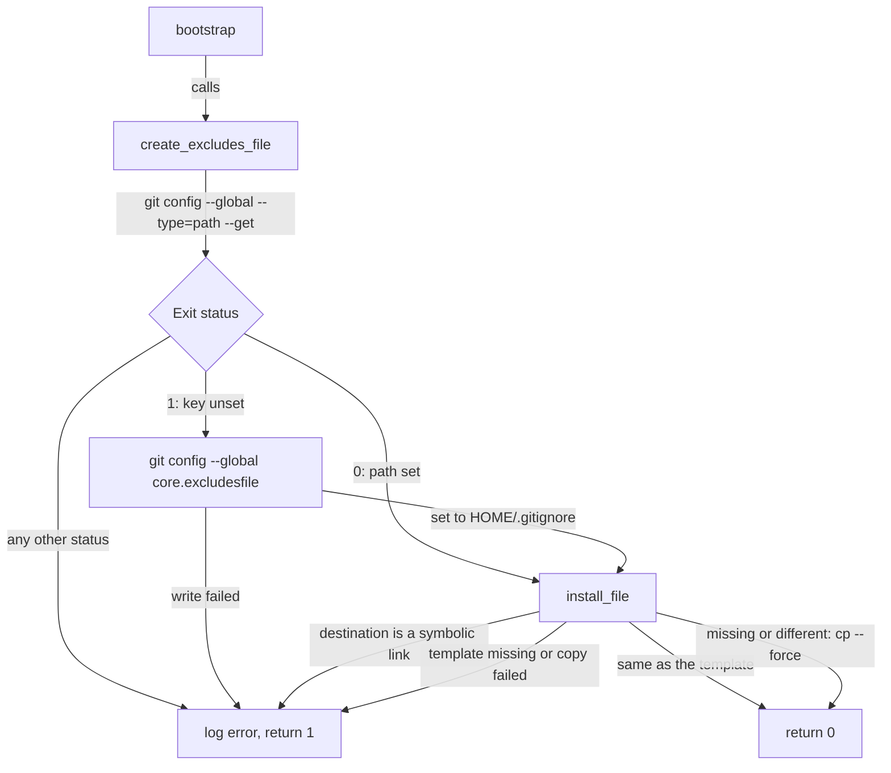

# Git module

How the `git` module installs a global gitignore and points git at it. It's for engineers who change [`src/modules/git/`](../src/modules/git/) or the patterns in its template.

## Contents

1. [Overview](#overview)
1. [How it works](#how-it-works)
1. [Interfaces](#interfaces)
1. [Errors and logging](#errors-and-logging)
1. [Security and privacy](#security-and-privacy)
1. [Decisions](#decisions)
1. [Limits](#limits)
1. [Sources](#sources)

## Overview

The module does one thing: it makes sure git's `core.excludesfile` names a file, and that the file holds the repository's template, [`templates/.gitignore`](../src/modules/git/templates/.gitignore). Git then ignores those patterns in every repository on the machine.

- [`src/install.sh`](../src/install.sh) runs the module only when `git` is on `PATH`, like every other module (see [Installer](installer.md)). It has no soft or optional dependencies.
- It doesn't set any other git config. The WSL user-data writes the user's `~/.gitconfig`, with settings such as the identity, signing key and default branch, and leaves `core.excludesfile` to this module (see [WSL provisioning](wsl/overview.md)).
- It runs for whoever runs the installer, so `sudo -H sh ./src/install.sh` gives root its own copy.

## How it works

[`bootstrap.sh`](../src/modules/git/bootstrap.sh) defines `bootstrap`, which calls `create_excludes_file` and turns its failure into an `errors` flag. This flowchart shows what `create_excludes_file` does:

1. It reads the current value with `git config --global --type=path --get core.excludesfile`. `--type=path` makes git expand `~` itself, so `~/my-ignore` becomes an absolute path (observed).
1. Exit status 1 means the key is unset. The module then sets it to `$HOME/.gitignore`, as an absolute path. Any other non-zero status, such as a malformed `~/.gitconfig`, is an error, and the module changes nothing (observed).
1. It hands the template and the path to `install_file` from [`common.sh`](../src/internal/common.sh). That helper leaves a symbolic link alone and skips a file that already matches. Otherwise it creates the directory and copies the template over the file.

On a rerun with nothing changed, `install_file` logs at debug level that the file is up to date, and the module writes nothing (observed).

### The template

[`templates/.gitignore`](../src/modules/git/templates/.gitignore) starts with a comment that says it's generated and that manual changes may be lost. It ignores:

- `.local/` anywhere, as a place in any repository for files that are never committed.
- `settings.local.json` anywhere, such as `.claude/settings.local.json` and `.vscode/settings.local.json`.
- Everything under any `.claude/` directory (`**/.claude/*`), then re-includes the shared project config that Claude Code reads from a repository, such as `CLAUDE.md`, `settings.json`, `rules/`, `skills/` and `hooks/`. `CLAUDE.local.md` is ignored anywhere too.
- Environment and secret files: `*.env`, `*.envrc`, `*.*_pass`, `*.*_password` and `*.*_passphrase`.
- The `*.secrets`, `*.vars` and `*.inputs` files that nektos/act reads.
- Windows and macOS metadata, such as `Thumbs.db`, `*:Zone.Identifier` and `.DS_Store`.

## Interfaces

| Input or output | What the module does with it |
| --- | --- |
| `core.excludesfile` in the global git config | Reads it, and sets it only when it's unset |
| `$HOME` | Default location of the gitignore, `$HOME/.gitignore` |
| The file `core.excludesfile` names | Created from the template when missing, overwritten when it differs |
| `$0` | The module is `eval`ed by `install.sh`, so it finds the template at `$(dirname "$0")/modules/git/templates/.gitignore` |
| Return value of `bootstrap` | 0 on success, 1 when anything failed |

`git config --global` writes to whichever global config file git picks. The module doesn't choose between `~/.gitconfig` and `$XDG_CONFIG_HOME/git/config` itself.

## Errors and logging

The module logs with `log` from [`logging.sh`](../src/internal/logging.sh), with paths wrapped as `<path>`.

| Situation | Log | Module result |
| --- | --- | --- |
| `git config --get` fails with a status other than 1 | error: `Failed to read global core.excludesfile.` | Fails |
| Setting `core.excludesfile` fails | error naming the path | Fails |
| The gitignore is a symbolic link | warning from `install_file`, then error | Fails, file left alone |
| The gitignore differs from the template | warning that it will be overwritten | Succeeds |
| The gitignore already matches | debug that it's up to date | Succeeds |
| The template is missing, or the directory or file can't be written | error from `install_file` | Fails |

Every failure ends with the error `Failed to create gitignore file.` from `bootstrap`. A failed module makes `install.sh` exit 1, but the other modules still run (observed).

## Security and privacy

- The template holds no identifying data, only generic patterns. Keep it that way: it's public and copied by other people.
- The secret-file patterns are a safety net against committing credentials, not a guarantee. A file that's already tracked stays tracked, and `git add -f` still adds an ignored file (git's documented behaviour).
- A new file gets the template's mode, less the `umask` (observed `0644`). It holds no secrets.

## Decisions

- **Respect an existing `core.excludesfile`.** If the user already points git at a file, the module writes the template there instead of moving the setting. This keeps one global ignore file.
- **Let git expand the path.** `--type=path` replaced a hand-written case for `~/`, so the module reads the path exactly as git would use it.
- **Treat only exit status 1 as unset.** Any other failure is reported, so the module never overwrites the user's setting or writes to a path it misread.
- **Install through `install_file`.** A rerun with an unchanged file is silent and a changed file is overwritten with a warning. A symbolic link is never followed. Someone who manages the file another way, such as with another dotfiles tool, can link it and keep control (inferred reason).
- **Ignore `.claude/` by default.** Claude Code keeps local state in `.claude/`, such as `worktrees/`, so the template ignores the directory and re-includes the shared files. `.mcp.json` sits outside `.claude/` and isn't ignored, because it holds team-shared MCP servers.
- **Ignore `settings.local.json` globally.** Claude Code adds `**/.claude/settings.local.json` to the global excludes file the first time it writes one, unless a repository already ignores it. The template already covers it, so Claude Code shouldn't need to change the file (inferred, untested).

## Limits

- A global gitignore the user wrote is replaced by the template on the first run, with only a warning in the log. There's no backup and no merge. Put personal patterns in a repository's `.git/info/exclude` or in a `.local/` directory instead.
- Anything that appends to the file, such as Claude Code adding a pattern, is overwritten on the next install, with a warning.
- The module manages only `core.excludesfile`. It doesn't set the identity, signing or any other git config.
- The patterns are the same on every machine. There's no per-host or per-user variation.

## Sources

- https://git-scm.com/docs/gitignore
- https://git-scm.com/docs/git-config
- https://code.claude.com/docs/en/settings
