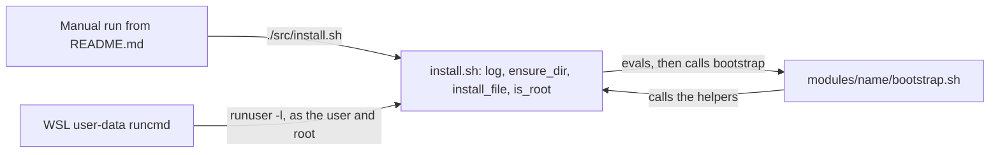
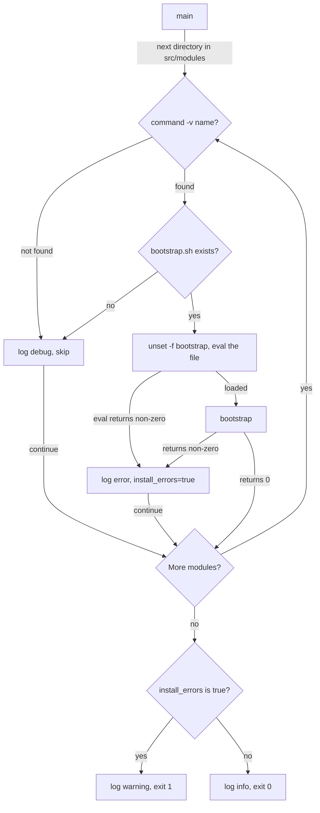

# Installer

How [`src/install.sh`](../src/install.sh) finds and runs the modules, and the helpers it defines for them. It's for anyone changing the installer, adding a module or calling a helper.

## Contents

1. [Overview](#overview)
1. [How it works](#how-it-works)
1. [Interfaces](#interfaces)
1. [Errors and logging](#errors-and-logging)
1. [Security and privacy](#security-and-privacy)
1. [Decisions](#decisions)
1. [Limits](#limits)
1. [Sources](#sources)

## Overview

The installer configures whoever runs it. It doesn't install packages or own any configuration itself: each module under `src/modules/` does that, and the installer decides which modules run and reports whether they all succeeded. The modules are described in [Git module](git-module.md), [Podman module](podman-module.md), [zsh module](zsh/overview.md) and [Claude module](claude/overview.md).

This diagram shows who runs the installer and what it loads:

People run it by hand as the [README](../README.md#usage) describes, and again with `sudo -H` to give root its own copy. The WSL user-data runs it for the user it creates and then for root (see [WSL provisioning](https://github.com/froazin/wsl/blob/main/docs/provisioning.md)).

## How it works

[`install.sh`](../src/install.sh) defines the helpers, then `main` loops over `$(dirname "$0")/modules/*` in glob order, which today is `claude`, `git`, `podman` and `zsh`.

This flowchart shows what `main` does with each module directory:

- **Gate:** a module runs only when a command with its directory's name is on `PATH`. That's the only hard dependency. Soft and optional dependencies are each module's own business (see [Dependencies](../README.md#dependencies)).
- **Load:** `install.sh` runs `eval "$(cat "$btstrpfile")"` in its own shell, with the output of the load itself sent to `/dev/null`. The module's functions and top-level variables then exist in the installer's shell.
- **Reset:** it runs `unset -f bootstrap` before each load. Without that, a module that defines no `bootstrap` would rerun the previous module's.
- **Run:** it calls `bootstrap`. A failure to load or run is logged as an error and recorded in `install_errors`, and the loop carries on with the next module.
- **Result:** `main` returns 1 if any module failed, and the script logs a warning and exits 1. Otherwise it logs success and exits 0.

## Interfaces

### Module contract

- Put the module in `src/modules/<name>/`, where `<name>` is the command it configures.
- Define a `bootstrap` function in `bootstrap.sh`. Return 0 when the configuration is installed, and non-zero when anything needs the user's attention, even if most of it worked.
- Resolve the module's own files from `$(dirname "$0")/modules/<name>/`. The file is evaluated by `install.sh`, so `$0` is `install.sh`.
- Prefix top-level names, as the modules do (`ZSH_SOFT_DEPS`, `claude_merge_json`). Everything a module defines stays in the shell for the modules after it.
- Write POSIX `sh`. The rule in [`.claude/rules/posix-sh.md`](../.claude/rules/posix-sh.md) holds the details.

### Shared helpers

The modules call these functions, which `install.sh` defines. Each returns non-zero on failure, and logs why where the table says so.

| Function | What it does | Used by |
| --- | --- | --- |
| `log <level> <message>` | Logs to the console and the log file. See [Errors and logging](#errors-and-logging) | Every module |
| `ensure_dir <dir>` | Creates the directory and its parents when it's missing. Logs an error if that fails | `claude`, `podman` |
| `install_file <src> <dest>` | Copies a template into place. See below | `claude`, `git`, `zsh` |
| `is_root` | True when `id -u` is 0 | `claude`, `zsh` |

`install_file` is how modules stay safe to rerun:

- A missing template is an error.
- A destination that's a symbolic link is left alone, with a warning, and the call fails.
- A destination identical to the template (`cmp -s`) is left alone, logged at `debug`.
- A different destination is overwritten with `cp --force`, with a warning first.
- The parent directory is created first.

### Environment variables

| Variable | Default | Effect |
| --- | --- | --- |
| `HOME` | Set by the login | Where the modules install, and where the log file goes by default |
| `PATH` | Set by the login | Which modules run |
| `DOTFILES_LOG_LEVEL` | `info` | The lowest level logged, to the console and the file alike. Case doesn't matter |
| `DOTFILES_LOG_FILE` | `$HOME/.local/var/log/dotfiles.log` | Where the log file goes |

Modules read their own variables, such as `CLAUDE_CONFIG_DIR` and `DOCKER_CONFIG`. Their docs list them.

## Errors and logging

[`install.sh`](../src/install.sh) defines `log`. It takes a level name (`trace`, `debug`, `info`, `warning`, `error` or `fatal`) and a message. By convention, messages wrap paths as `<path>`.

- **Console:** a coloured `<timestamp> [LEVEL] <message>` line on stderr, only when stderr is a terminal. When stderr is redirected, nothing reaches the console (observed). Piping only stdout doesn't hide it.
- **File:** one JSON object per line, with `timestamp`, `level` and `message`, appended to `DOTFILES_LOG_FILE`. The level is the console label in lowercase, so `warning` is written as `warn` (observed). `log` creates the directory and the file (mode 644) when they're missing.
- **Filter:** messages below `DOTFILES_LOG_LEVEL` go nowhere. Set it to `debug` to see each skipped module and each file that was already up to date.
- **Fatal:** `log fatal` writes the line and then exits 1. Since modules run in the installer's process, that ends the whole run. No module calls it on this branch.
- **Write failures:** if the log directory or file can't be created, `log` still prints to the console and returns 1. If the file exists but can't be appended to, the line is lost and `log` returns 0 (both observed).

The installer's own exit status is 0 when every module that ran succeeded, and 1 when any failed to load or run. A run can also end early with another status. See [Limits](#limits).

## Security and privacy

- The installer and every module run with the full rights of the person who runs them, and with `sudo`, as root. Anything in a module's bootstrap file runs, so treat a change under `src/modules/` as code you'd run as root.
- Root's install uses `sudo -H`, so `HOME` is root's. `install_file` copies templates, so root gets copies rather than links to the user's files (see [Root](../README.md#root)).
- `install.sh` creates the log file readable by everyone (mode 644), and it holds paths under the home directory. It never logs file contents.
- The installer holds nothing identifying. It works out where to install from the environment, such as `HOME`.

## Decisions

- **POSIX `sh`:** `install.sh` is POSIX `sh`, so it doesn't need zsh or bash to run. Only the files it installs are zsh-specific.
- **Helpers in the installer:** the helpers used to live in `src/internal/`. They moved into `install.sh`, so the installer is one file, and the helpers no module called (`check_commands`, `get_distro_name`, `is_devcontainer`, `is_wsl`, and the GitHub API wrappers in `github.sh`) were deleted.
- **One gate per module:** a module is skipped only when its own command is missing. Other missing tools don't stop the configuration being installed, so it starts working once they arrive, without a reinstall.
- **Collect failures, don't stop:** one failed module doesn't stop the others. The run still exits 1 at the end, so the user notices.
- **Evaluate modules in the installer's shell:** in `sh`, modules call `log` and `install_file` without sourcing anything. The cost is a shared namespace, which is why the flag is `install_errors` rather than the `errors` each module resets, and why `bootstrap` is unset before each load. The code doesn't record why it uses `eval` rather than `.`.
- **Leave symbolic links alone:** `install_file` doesn't replace a link the user made, but fails so the run reports it.
- **No `ensure_dir` in the logger:** the logger creates its directory itself, because a failure in `ensure_dir` would log and recurse back into it.

## Limits

- A syntax error in a module's `bootstrap.sh` ends the whole run. Under `dash`, Ubuntu's `sh`, it exits with status 2, skips the later modules and logs no summary (observed). Only an `eval` that runs and returns non-zero is caught as "Failed to load".
- An unknown level name, such as `log warn`, isn't printed, is written to the file as `invalid` and then exits 1, like `fatal` (observed).
- An unknown `DOTFILES_LOG_LEVEL`, such as `verbose`, hides every message with a known level, and `log fatal` then returns without exiting (observed).
- `log` doesn't escape the message, so a `"` or `\` in it makes that line invalid JSON (observed). Some module messages contain quotes.
- POSIX `sh` has no `local`, so helpers set globals: `log` sets `level`, `msg` and `timestamp`. A caller using those names loses its value (inferred from the code).
- `install.sh` uses GNU options: `date --iso-8601=seconds` and `cp --force`. Systems without GNU coreutils, such as macOS, aren't supported (inferred, untested).
- Modules run in name order, and a module can't declare that it needs another.
- There's no uninstall and no dry run. Removing a module's files is manual.

## Sources

- https://pubs.opengroup.org/onlinepubs/9699919799/utilities/V3_chap02.html
