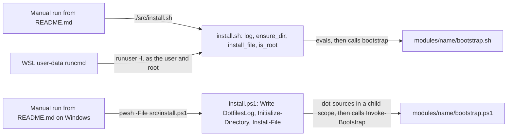
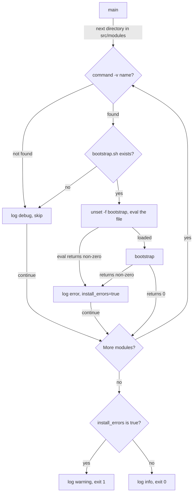

# Installer

How the two installers find and run the modules, and the helpers the modules call: [`src/install.sh`](../src/install.sh) on Linux and [`src/install.ps1`](../src/install.ps1), its PowerShell twin, on Windows. It's for anyone changing an installer, adding a module or calling a helper.

## Contents

1. [Overview](#overview)
1. [How it works](#how-it-works)
1. [The Windows installer](#the-windows-installer)
1. [Interfaces](#interfaces)
1. [Errors and logging](#errors-and-logging)
1. [Security and privacy](#security-and-privacy)
1. [Decisions](#decisions)
1. [Limits](#limits)
1. [Sources](#sources)

## Overview

The installers configure whoever runs them. They don't install packages or own any configuration themselves: each module under `src/modules/` does that, and the installer decides which modules run and reports whether they all succeeded. The modules are described in [Git module](git-module.md), [Podman module](podman-module.md), [zsh module](zsh/overview.md), [pwsh module](pwsh-module.md) and [Claude module](claude/overview.md).

A module takes part on a platform by having a bootstrap file for it: `bootstrap.sh` for `install.sh` and `bootstrap.ps1` for `install.ps1`. Today that's:

| Module | `bootstrap.sh` (Linux) | `bootstrap.ps1` (Windows) |
| --- | --- | --- |
| `claude` | Yes | Yes |
| `git` | Yes | Yes |
| `podman` | Yes | No |
| `pwsh` | No | Yes |
| `zsh` | Yes | No |

This diagram shows who runs each installer and what it loads:

People run `install.sh` by hand as the [README](../README.md#usage) describes, and again with `sudo -H` to give root its own copy. The WSL user-data runs it for the user it creates and then for root (see [WSL provisioning](https://github.com/froazin/wsl/blob/main/docs/provisioning.md)). Nothing runs `install.ps1` automatically: people run it by hand, as the README's [Windows](../README.md#windows) section describes.

## How it works

[`install.sh`](../src/install.sh) defines the helpers, then `main` loops over `$(dirname "$0")/modules/*` in glob order, which today is `claude`, `git`, `podman`, `pwsh` and `zsh`.

This flowchart shows what `main` does with each module directory:

- **Gate:** a module runs only when a command with its directory's name is on `PATH`. That's the only hard dependency. Soft and optional dependencies are each module's own business (see [Dependencies](../README.md#dependencies)).
- **Load:** `install.sh` runs `eval "$(cat "$btstrpfile")"` in its own shell, with the output of the load itself sent to `/dev/null`. The module's functions and top-level variables then exist in the installer's shell.
- **Reset:** it runs `unset -f bootstrap` before each load. Without that, a module that defines no `bootstrap` would rerun the previous module's.
- **Run:** it calls `bootstrap`. A failure to load or run is logged as an error and recorded in `install_errors`, and the loop carries on with the next module.
- **Result:** `main` returns 1 if any module failed, and the script logs a warning and exits 1. Otherwise it logs success and exits 0.

A module with only a `bootstrap.ps1`, such as `pwsh`, is skipped with a debug message when its command is installed on Linux.

## The Windows installer

[`install.ps1`](../src/install.ps1) does the same in PowerShell, with the same log levels, log file and messages. Where the two differ, it's because PowerShell does something better natively:

- **Gate:** `Get-Command <name> -CommandType Application`, so a function or alias of that name doesn't count, but a `.cmd` or `.bat` does.
- **Skip:** a module without a `bootstrap.ps1`, such as `podman` and `zsh`, is skipped with a debug message, as `install.sh` skips one without a `bootstrap.sh`.
- **Load and run:** `Invoke-Module` dot-sources the file inside a script block, `& { . $file; Invoke-Bootstrap }`, so the module gets a scope of its own. What a module defines is gone when it finishes, so nothing needs resetting and names can't clash between modules. The installer's helpers are in the script scope, so modules see them.
- **Failures:** a parse error or an exception while loading is caught and logged as "Failed to load". A module that defines no `Invoke-Bootstrap` is a load failure too. An exception from `Invoke-Bootstrap` is "Failed to execute", with its message.
- **Result:** `Invoke-Bootstrap` must return exactly `$true` or `$false`. Anything else, such as stray pipeline output added to the return value, fails the module with a message saying so, so a leak is found rather than hidden.
- **Dot-sourcing:** `. ./src/install.ps1` defines the helpers without installing anything. The Pester tests use that.
- **Strict mode:** the installer sets `Set-StrictMode -Version 3.0`, which modules inherit, so an unset variable or a missing property is an exception rather than `$null`.

It runs on PowerShell 7 and on Windows PowerShell 5.1. CI runs it with both (see [CI](ci.md)).

## Interfaces

### Module contract

- Put the module in `src/modules/<name>/`, where `<name>` is the command it configures.
- For Linux, define a `bootstrap` function in `bootstrap.sh`. Return 0 when the configuration is installed, and non-zero when anything needs the user's attention, even if most of it worked.
  - Resolve the module's own files from `$(dirname "$0")/modules/<name>/`. The file is evaluated by `install.sh`, so `$0` is `install.sh`.
  - Prefix top-level names, as the modules do (`ZSH_SOFT_DEPS`, `claude_merge_json`). Everything a module defines stays in the shell for the modules after it.
  - Write POSIX `sh`. The rule in [`.claude/rules/posix-sh.md`](../.claude/rules/posix-sh.md) holds the details.
- For Windows, define an `Invoke-Bootstrap` function in `bootstrap.ps1` that returns `$true` or `$false` on the same terms.
  - Resolve the module's own files from `$PSScriptRoot`, which is the module's directory.
  - Prefix the module's names too (`Merge-ClaudeJson`, `$PwshSoftDeps`), to keep them apart from the installer's.
  - Run on PowerShell 7 and 5.1, and pass PSScriptAnalyzer. The rule in [`.claude/rules/powershell.md`](../.claude/rules/powershell.md) holds the details.

### Shared helpers

The modules call these functions, which each installer defines. Each fails (returns non-zero in `sh`, `$false` in PowerShell) on failure, and logs why where the table says so.

| `install.sh` | `install.ps1` | What it does | Used by |
| --- | --- | --- | --- |
| `log <level> <message>` | `Write-DotfilesLog <level> <message>` | Logs to the console and the log file. See [Errors and logging](#errors-and-logging) | Every module |
| `ensure_dir <dir>` | `Initialize-Directory <dir>` | Creates the directory and its parents when it's missing. Logs an error if that fails | `claude`, `podman` (sh); `claude`, `pwsh` (ps1, through `Install-File`) |
| `install_file <src> <dest>` | `Install-File <src> <dest>` | Copies a template into place. See below | `claude`, `git`, `zsh`; `claude`, `git`, `pwsh` |
| `is_root` | — | True when `id -u` is 0 | `claude`, `zsh` |

`install.ps1` has no `is_root`. An elevated PowerShell on Windows still has the user's own profile, so there's no separate root install to treat differently.

Both copies of `install_file` are how modules stay safe to rerun:

- A missing template is an error.
- A destination that's a symbolic link is left alone, with a warning, and the call fails. In PowerShell that's a `SymbolicLink` or `Junction` by `LinkType`: OneDrive's cloud files are reparse points too, and are treated as plain files.
- A destination identical to the template is left alone, logged at `debug`: `cmp -s` in `sh`, and a byte-for-byte comparison in .NET in PowerShell. Not `Get-FileHash`, which Windows PowerShell can't load when it inherits pwsh's `PSModulePath`, as it does when started from pwsh (observed).
- A different destination is overwritten with a warning first: `cp --force` in `sh`, `Copy-Item -Force` in PowerShell.
- The parent directory is created first.

### Environment variables

| Variable | Default | Effect |
| --- | --- | --- |
| `HOME` | Set by the login | Where the Linux modules install, and where the log file goes by default. PowerShell's `$HOME`, which comes from `USERPROFILE` on Windows, plays the same part for `install.ps1` |
| `USERPROFILE` | Set by the login | Windows only: PowerShell's `$HOME`, and the Documents folder that holds the pwsh profile normally follows it |
| `PATH` | Set by the login | Which modules run |
| `DOTFILES_LOG_LEVEL` | `info` | The lowest level logged, to the console and the file alike. Case doesn't matter |
| `DOTFILES_LOG_FILE` | `$HOME/.local/var/log/dotfiles.log` | Where the log file goes. `install.ps1` uses `~\.local\var\log\dotfiles.log` the same way |

Modules read their own variables, such as `CLAUDE_CONFIG_DIR` and `DOCKER_CONFIG`. Their docs list them.

## Errors and logging

`log` in [`install.sh`](../src/install.sh), and `Write-DotfilesLog` in [`install.ps1`](../src/install.ps1), take a level name (`trace`, `debug`, `info`, `warning`, `error` or `fatal`) and a message. By convention, messages wrap paths as `<path>`.

- **Console:** a coloured `<timestamp> [LEVEL] <message>` line on stderr, only when stderr is a terminal. When stderr is redirected, nothing reaches the console (observed). Piping only stdout doesn't hide it. PowerShell drops the colours in a host without virtual terminal support.
- **File:** one JSON object per line, with `timestamp`, `level` and `message`, appended to `DOTFILES_LOG_FILE`. The level is the console label in lowercase, so `warning` is written as `warn` (observed). The logger creates the directory and the file when they're missing; `install.sh` makes the file mode 644.
- **Filter:** messages below `DOTFILES_LOG_LEVEL` go nowhere. Set it to `debug` to see each skipped module and each file that was already up to date.
- **Fatal:** `fatal` writes the line and then exits 1. Since modules run in the installer's process, that ends the whole run. No module calls it on this branch. In PowerShell, `fatal` exits even when `DOTFILES_LOG_LEVEL` would hide it.
- **Helper errors:** in `install.ps1`, `Initialize-Directory` and `Install-File` end "Failed to create directory" and "Failed to write" with the exception's message, such as `Access to the path ... is denied.` The `sh` helpers don't.
- **Write failures:** if the log directory or file can't be created, `log` still prints to the console and returns 1. If the file exists but can't be appended to, the line is lost and `log` returns 0 (both observed). `Write-DotfilesLog` loses the line silently in both cases.

`Write-DotfilesLog` builds its JSON with `ConvertTo-Json`, so any message is valid JSON. Windows PowerShell 5.1 escapes `<` and `>` as `\u003c` and `\u003e`, which JSON readers decode as the same characters (observed).

The installer's own exit status is 0 when every module that ran succeeded, and 1 when any failed to load or run. A run can also end early with another status. See [Limits](#limits).

## Security and privacy

- Each installer and every module run with the full rights of the person who runs them, and `install.sh` with `sudo`, as root. Anything in a module's bootstrap file runs, so treat a change under `src/modules/` as code you'd run as root.
- Root's install uses `sudo -H`, so `HOME` is root's. `install_file` copies templates, so root gets copies rather than links to the user's files (see [Root](../README.md#root)).
- `install.sh` creates the log file readable by everyone (mode 644), and it holds paths under the home directory. On Windows the log file inherits the profile directory's permissions, which keep other users out. Neither installer logs file contents.
- The installers hold nothing identifying. They work out where to install from the environment, such as `HOME` or `USERPROFILE`.
- PowerShell's execution policy applies to `install.ps1`. pwsh's default on Windows, `RemoteSigned`, runs it from a `git clone`. Windows PowerShell's default, `Restricted`, needs `-ExecutionPolicy Bypass` for that one process, as the README shows. A clone from a downloaded zip carries the mark of the web, so `RemoteSigned` blocks it too, until `Unblock-File` (inferred).

## Decisions

- **POSIX `sh`:** `install.sh` is POSIX `sh`, so it doesn't need zsh or bash to run. Only the files it installs are zsh-specific.
- **A PowerShell twin, not one installer for both:** Windows has no `sh` unless Git for Windows is installed, and PowerShell is always there. `install.ps1` mirrors `install.sh` closely so that one doc, and the same habits, cover both.
- **PowerShell 7 first, 5.1 compatible:** the user's shell is PowerShell 7, but Windows PowerShell 5.1 is on every Windows machine, so both installers and the Windows hooks run on either.
- **Helpers in the installers:** the helpers used to live in `src/internal/`. They moved into `install.sh` and `install.ps1`, so each installer is one file, and the helpers no module called (`check_commands`, `get_distro_name`, `is_devcontainer`, `is_wsl`, and the GitHub API wrappers in `github.sh`) were deleted.
- **One gate per module:** a module is skipped only when its own command is missing. Other missing tools don't stop the configuration being installed, so it starts working once they arrive, without a reinstall.
- **Collect failures, don't stop:** one failed module doesn't stop the others. The run still exits 1 at the end, so the user notices.
- **Evaluate modules in the installer's shell:** in `sh`, modules call `log` and `install_file` without sourcing anything. The cost is a shared namespace, which is why the flag is `install_errors` rather than the `errors` each module resets, and why `bootstrap` is unset before each load. The code doesn't record why it uses `eval` rather than `.`. PowerShell's script blocks give each module its own scope instead.
- **Leave symbolic links alone:** `install_file` doesn't replace a link the user made, but fails so the run reports it.
- **No `ensure_dir` in the logger:** the logger creates its directory itself, because a failure in `ensure_dir` would log and recurse back into it. `Write-DotfilesLog` does the same.

## Limits

- A syntax error in a module's `bootstrap.sh` ends the whole run. Under `dash`, Ubuntu's `sh`, it exits with status 2, skips the later modules and logs no summary (observed). Only an `eval` that runs and returns non-zero is caught as "Failed to load". `install.ps1` catches a parse error in `bootstrap.ps1` and carries on.
- An unknown level name, such as `log warn`, isn't printed, is written to the file as `invalid` and then exits 1, like `fatal` (observed). `Write-DotfilesLog` rejects it with a parameter error, which fails the module that called it.
- An unknown `DOTFILES_LOG_LEVEL`, such as `verbose`, hides every message with a known level, and `log fatal` then returns without exiting (observed).
- `log` doesn't escape the message, so a `"` or `\` in it makes that line invalid JSON (observed). Some module messages contain quotes. `Write-DotfilesLog` doesn't have this problem.
- POSIX `sh` has no `local`, so helpers set globals: `log` sets `level`, `msg` and `timestamp`. A caller using those names loses its value (inferred from the code).
- `install.sh` uses GNU options: `date --iso-8601=seconds` and `cp --force`. Systems without GNU coreutils, such as macOS, aren't supported (inferred, untested).
- Modules run in name order, and a module can't declare that it needs another.
- There's no uninstall and no dry run. Removing a module's files is manual.

## Sources

- https://pubs.opengroup.org/onlinepubs/9699919799/utilities/V3_chap02.html
- https://learn.microsoft.com/powershell/module/microsoft.powershell.core/about/about_scopes
- https://learn.microsoft.com/powershell/module/microsoft.powershell.core/about/about_execution_policies
