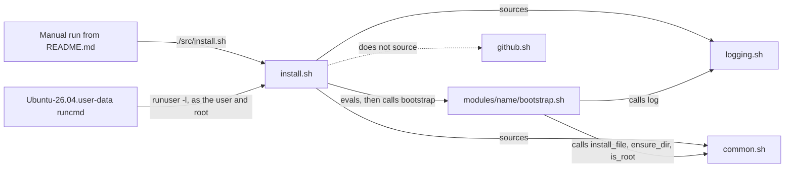
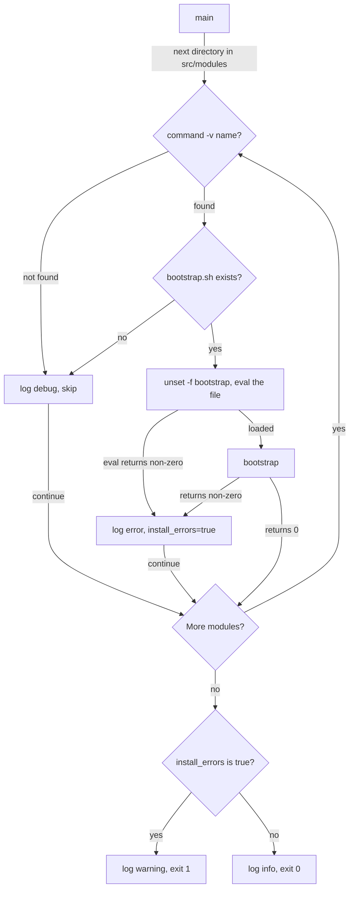

# Installer

How [`src/install.sh`](../src/install.sh) finds and runs the modules, and the shared helpers in [`src/internal/`](../src/internal/) that the modules call. It's for anyone changing the installer, adding a module or calling a helper.

## Contents

1. [Overview](#overview)
1. [How it works](#how-it-works)
1. [Interfaces](#interfaces)
1. [Errors and logging](#errors-and-logging)
1. [GitHub API helpers](#github-api-helpers)
1. [Security and privacy](#security-and-privacy)
1. [Decisions](#decisions)
1. [Limits](#limits)
1. [Sources](#sources)

## Overview

The installer configures whoever runs it. It doesn't install packages or own any configuration itself: each module under `src/modules/` does that, and the installer decides which modules run and reports whether they all succeeded. The modules are described in [Git module](git-module.md), [Podman module](podman-module.md), [zsh module](zsh/overview.md) and [Claude module](claude/overview.md).

This diagram shows who runs the installer and what it loads:

People run it by hand as the [README](../README.md#usage) describes, and again with `sudo -H` to give root its own copy. The WSL user-data runs it for the new user and then for root, or only for root from a temporary clone when no username is given (see [WSL provisioning](wsl/overview.md)).

## How it works

[`install.sh`](../src/install.sh) sources [`logging.sh`](../src/internal/logging.sh) and [`common.sh`](../src/internal/common.sh) from `$(dirname "$0")/internal/`. If either file can't be opened, `dash` ends the run there with status 2, before the `|| exit 1` runs (observed). Then `main` loops over `$(dirname "$0")/modules/*` in glob order, which today is `claude`, `git`, `podman` and `zsh`.

This flowchart shows what `main` does with each module directory:

- **Gate:** a module runs only when a command with its directory's name is on `PATH`. That's the only hard dependency. Soft and optional dependencies are each module's own business (see [Dependencies](../README.md#dependencies)).
- **Load:** `install.sh` runs `eval "$(cat "$btstrpfile")"` in its own shell, with the output of the load itself sent to `/dev/null`. The module's functions and top-level variables then exist in the installer's shell.
- **Reset:** it runs `unset -f bootstrap` before each load. Without that, a module that defines no `bootstrap` would rerun the previous module's.
- **Run:** it calls `bootstrap`. A failure to load or run is logged as an error and recorded in `install_errors`, and the loop carries on with the next module.
- **Result:** `main` returns 1 if any module failed, and the script logs a warning and exits 1. Otherwise it logs success and exits 0.

## Interfaces

### Module contract

- Put the module in `src/modules/<name>/`, where `<name>` is the command it configures.
- Define a `bootstrap` function in `bootstrap.sh`. Return 0 when the configuration is installed, and non-zero when anything needs the user's attention, even if most of it worked.
- Resolve the module's own files from `$(dirname "$0")/modules/<name>/`. The file is evaluated by `install.sh`, so `$0` is `install.sh`.
- Prefix top-level names, as the modules do (`ZSH_SOFT_DEPS`, `claude_merge_json`). Everything a module defines stays in the shell for the modules after it.
- Write POSIX `sh`. The rule in [`.claude/rules/posix-sh.md`](../.claude/rules/posix-sh.md) holds the details.

### Shared helpers

The modules call these functions from [`common.sh`](../src/internal/common.sh) and [`logging.sh`](../src/internal/logging.sh). Each returns non-zero on failure, and logs why where the table says so.

| Function | What it does | Used by |
| --- | --- | --- |
| `log <level> <message>` | Logs to the console and the log file. See [Errors and logging](#errors-and-logging). It's in `logging.sh` | Every module |
| `ensure_dir <dir>` | Runs `mkdir -p` when the directory is missing. Logs an error if that fails | `claude`, `podman` |
| `install_file <src> <dest>` | Copies a template into place. See below | `claude`, `git`, `zsh` |
| `is_root` | True when `id -u` is 0 | `zsh` |
| `check_commands <cmd>...` | Logs an error for each command not on `PATH`, and fails if any is missing | Nothing on this branch |
| `get_distro_name` | Prints `debian`, `ubuntu` or `alpine`, or `redhat` for `redhat`, `centos` and `fedora`, from `ID=` in `/etc/os-release`. Logs an error for anything else | Nothing on this branch |
| `is_devcontainer` | True when `REMOTE_CONTAINERS` is `true` | Nothing on this branch |
| `is_wsl` | True when `/proc/version` contains `microsoft` | Nothing on this branch |

`install_file` is how modules stay safe to rerun:

- A missing template is an error.
- A destination that's a symbolic link is left alone, with a warning, and the call fails.
- A destination identical to the template (`cmp -s`) is left alone, logged at `debug`.
- A different destination is overwritten with `cp --force`, with a warning first.
- The parent directory is created with `ensure_dir`.

### Environment variables

| Variable | Default | Effect |
| --- | --- | --- |
| `HOME` | Set by the login | Where the modules install, and where the log file goes by default |
| `PATH` | Set by the login | Which modules run |
| `DOTFILES_LOG_LEVEL` | `info` | The lowest level logged, to the console and the file alike. Case doesn't matter |
| `DOTFILES_LOG_FILE` | `$HOME/.local/var/log/dotfiles.log` | Where the log file goes |

Modules read their own variables, such as `CLAUDE_CONFIG_DIR` and `DOCKER_CONFIG`. Their docs list them.

## Errors and logging

[`logging.sh`](../src/internal/logging.sh) defines `log`. It takes a level name (`trace`, `debug`, `info`, `warning`, `error` or `fatal`) and a message. By convention, messages wrap paths as `<path>`.

- **Console:** a coloured `<timestamp> [LEVEL] <message>` line on stderr, only when stderr is a terminal. When stderr is redirected, nothing reaches the console (observed). Piping only stdout doesn't hide it.
- **File:** one JSON object per line, with `timestamp`, `level` and `message`, appended to `DOTFILES_LOG_FILE`. The level is the console label in lowercase, so `warning` is written as `warn` (observed). `log` creates the directory and the file (mode 644) when they're missing.
- **Filter:** messages below `DOTFILES_LOG_LEVEL` go nowhere. Set it to `debug` to see each skipped module and each file that was already up to date.
- **Fatal:** `log fatal` writes the line and then exits 1. Since modules run in the installer's shell, that ends the whole run. No module calls it on this branch.
- **Write failures:** if the log directory or file can't be created, `log` still prints to the console and returns 1. If the file exists but can't be appended to, the line is lost and `log` returns 0 (both observed).

The installer's own exit status is 0 when every module that ran succeeded, and 1 when any failed to load or run. A run can also end early with another status. See [Limits](#limits).

## GitHub API helpers

[`github.sh`](../src/internal/github.sh) wraps the GitHub REST API with `curl`. `install.sh` doesn't source it and no module uses it on this branch, so the installer doesn't need `curl` or `jq`. These descriptions come from reading the code. The functions are untested here.

- `github_api_request <method> <uri> [body]` accepts `GET`, `POST`, `PUT` or `DELETE`, strips a leading `/` from the URI and runs `curl -fL` against `https://api.github.com/<uri>`. It prints the response body.
- With `GITHUB_TOKEN` set, it adds an `Authorization: token` header and logs that it's using the token, but not the token itself.
- A body must parse as JSON with `jq`, and is sent compacted with `Content-Type: application/json`.
- `get_github_release_with_tag <owner> <repo> <tag>` reads `releases/latest` when the tag is `latest`, and `releases/tags/<tag>` otherwise. `get_github_latest_release <owner> <repo>` is the `latest` shortcut.
- `get_github_refs <owner> <repo> [ref]` reads `git/refs` or `git/refs/<ref>`, and a partial ref returns every match. `get_github_ref <owner> <repo> <ref>` reads one ref from `git/ref/<ref>`.
- The `get_github_*` functions send stderr to `/dev/null`. Since `log` writes to stderr, their error messages reach only the log file (inferred).

## Security and privacy

- The installer and every module run with the full rights of the person who runs it, and with `sudo`, as root. Anything in a module's `bootstrap.sh` runs, so treat a change under `src/modules/` as code you'd run as root.
- Root's install uses `sudo -H`, so `HOME` is root's. `install_file` copies templates, so root gets copies rather than links to the user's files (see [Root](../README.md#root)).
- `log` creates the log file readable by everyone (mode 644), and it holds paths under the home directory. The installer and helpers don't log file contents or the GitHub token (inferred from the messages in the code).
- The installer holds nothing identifying. It works out where to install from the environment, such as `HOME`.

## Decisions

- **POSIX `sh`:** the install scripts are POSIX `sh`, so they don't need zsh or bash to run. Only the files they install are zsh-specific.
- **One gate per module:** a module is skipped only when its own command is missing. Other missing tools don't stop the configuration being installed, so it starts working once they arrive, without a reinstall.
- **Collect failures, don't stop:** one failed module doesn't stop the others. The run still exits 1 at the end, so the user notices.
- **Evaluate modules in the installer's shell:** modules call `log` and `install_file` without sourcing anything. The cost is a shared namespace, which is why the flag is `install_errors` rather than the `errors` each module resets, and why `bootstrap` is unset before each load. The code doesn't record why it uses `eval` rather than `.`.
- **Leave symbolic links alone:** `install_file` doesn't replace a link the user made, but fails so the run reports it.
- **No `ensure_dir` in the logger:** `_log_to_file` creates its directory itself, because a failure in `ensure_dir` would log and recurse back into it.
- **Keep `github.sh` out of the installer:** it needs `curl`, and `jq` for request bodies, and the installer mustn't depend on either.

## Limits

- A syntax error in a module's `bootstrap.sh` ends the whole run. Under `dash`, Ubuntu's `sh`, it exits with status 2, skips the later modules and logs no summary (observed). A missing `logging.sh` or `common.sh` also exits with status 2. Only an `eval` that runs and returns non-zero is caught as "Failed to load".
- An unknown level name, such as `log warn`, isn't printed, is written to the file as `invalid` and then exits 1, like `fatal` (observed).
- An unknown `DOTFILES_LOG_LEVEL`, such as `verbose`, hides every message with a known level, and `log fatal` then returns without exiting (observed).
- `log` doesn't escape the message, so a `"` or `\` in it makes that line invalid JSON (observed). Some module messages contain quotes.
- POSIX `sh` has no `local`, so helpers set globals: `log` sets `level`, `msg` and `timestamp`, and `check_commands` sets `failed`. A caller using those names loses its value (inferred from the code).
- The helpers use GNU options: `date --iso-8601=seconds` and `cp --force`. Systems without GNU coreutils, such as macOS, aren't supported (inferred, untested).
- Modules run in glob order, and a module can't declare that it needs another.
- There's no uninstall and no dry run. Removing a module's files is manual.

## Sources

- https://pubs.opengroup.org/onlinepubs/9699919799/utilities/V3_chap02.html
