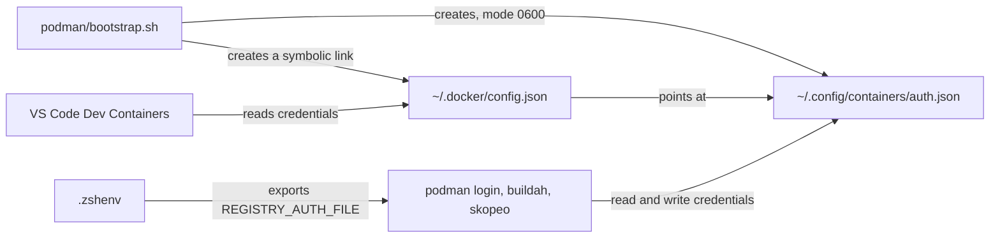
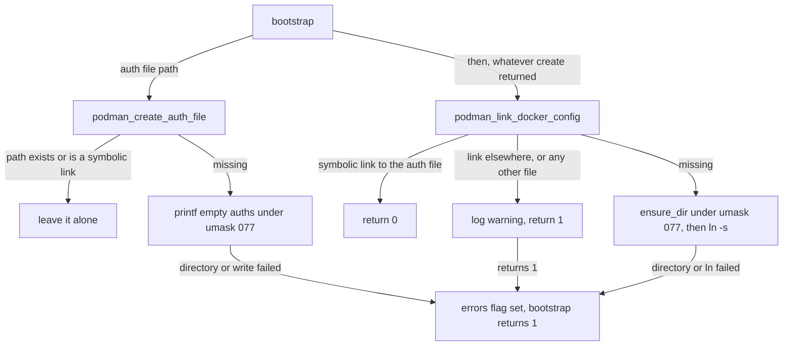

# Podman module

How the `podman` module keeps container registry credentials in one persistent file that both podman and Docker tooling read. It's for engineers who change [`src/modules/podman/`](../src/modules/podman/) or the zsh code that uses its file.

## Contents

1. [Overview](#overview)
1. [How it works](#how-it-works)
1. [Interfaces](#interfaces)
1. [Errors and logging](#errors-and-logging)
1. [Security and privacy](#security-and-privacy)
1. [Decisions](#decisions)
1. [Limits](#limits)
1. [Sources](#sources)

## Overview

`podman login` saves credentials in `${XDG_RUNTIME_DIR}/containers/auth.json` by default. That runtime directory is temporary: the code's comment says the credentials are lost at logout. The module creates the persistent file podman also reads, `~/.config/containers/auth.json`, and links `~/.docker/config.json` to it, so Docker tooling such as VS Code Dev Containers sees the same credentials.

- [`src/install.sh`](../src/install.sh) runs the module only when `podman` is on `PATH` (see [Installer](installer.md)). It has no other dependencies.
- It never logs in, stores a credential or edits an existing file.
- The zsh environment does the runtime part: it exports `REGISTRY_AUTH_FILE` and `DOCKER_HOST` (see [Zsh module](zsh/overview.md)). The WSL user-data installs podman and enables `podman.socket` (see [WSL provisioning](wsl/overview.md)).

This diagram shows who reads and writes the file once the module and the zsh config are installed:

## How it works

[`bootstrap.sh`](../src/modules/podman/bootstrap.sh) defines `bootstrap`, which works out the auth file path as `${XDG_CONFIG_HOME:-$HOME/.config}/containers/auth.json` and passes it to two functions. It runs the second whatever the first returned:

### `podman_create_auth_file`

1. If the path exists, or is a symbolic link (even a broken one), it returns 0 and leaves it alone.
1. Otherwise it creates the directory with `ensure_dir` from [`common.sh`](../src/internal/common.sh).
1. It writes `{"auths": {}}`, tab-indented, in a subshell with `umask 077`, so the file is created with mode `0600` (observed).

### `podman_link_docker_config`

The Docker config path is `${DOCKER_CONFIG:-$HOME/.docker}/config.json`.

1. If it's a symbolic link whose `readlink` target is exactly the auth file path, it returns 0.
1. If it's a link to anything else, or any other existing file, it logs a warning and returns 1. It never replaces it.
1. Otherwise it creates the Docker directory, when it's missing, in a subshell with `umask 077` (observed mode `0700`). Then it runs `ln -s` with the auth file path, which is absolute when `HOME` is.

On a rerun with nothing changed, both functions log at debug level only, and the module succeeds (observed).

## Interfaces

| Input or output | What the module does with it |
| --- | --- |
| `XDG_CONFIG_HOME`, `HOME` | Locate the auth file |
| `DOCKER_CONFIG`, `HOME` | Locate the Docker config |
| `~/.config/containers/auth.json` | Created when missing, never changed after that |
| `~/.docker/config.json` | Created as a symbolic link when missing, never changed after that |
| Return value of `bootstrap` | 0 on success, 1 when either function failed |

[`.zshenv`](../src/modules/zsh/templates/.zshenv) depends on this layout. It exports `REGISTRY_AUTH_FILE` only when all of these hold:

- `REGISTRY_AUTH_FILE` isn't already set, and `podman` is on `PATH`.
- The auth file exists and the user owns it. Its comment says buildah refuses a missing `REGISTRY_AUTH_FILE`.
- The Docker config is missing or is the same file (`-ef`). Setting the variable stops podman reading any other auth file, so a separate Docker config would lose its credentials.

`.zshenv` exports the resolved path (`${_podman_auth:A}`). Its comment says this is so podman's atomic writes keep a link in place (not tested here).

## Errors and logging

The module logs with `log` from [`logging.sh`](../src/internal/logging.sh), with paths wrapped as `<path>`.

| Situation | Log | Module result |
| --- | --- | --- |
| Auth file exists | debug | Succeeds |
| Auth file can't be written | error from each level | Fails |
| Docker config already links to the auth file | debug | Succeeds |
| Docker config links elsewhere | warning naming both targets, then error | Fails |
| Docker config is any other existing file | warning telling the user to move its `"auths"` into the auth file, remove it and rerun, then error | Fails |
| Docker directory or link can't be created | error | Fails |

A failure here makes `install.sh` exit 1, but the other modules still run. When only the link fails, the auth file is still created (observed).

## Security and privacy

- The auth file holds registry credentials once someone logs in, and `~/.docker/config.json` exposes the same file. The auth file is created `0600` and a new `~/.docker` `0700`. The code's comment says `0600` is what `podman login` would create. `~/.config/containers` itself gets the default `umask` (observed `0755`).
- The module writes no credential, and logs paths only, never file contents.
- It never follows or replaces an existing link or file, so it can't redirect credentials that another tool already manages.

## Decisions

- **Use the persistent fallback, not a new location.** Podman already searches `${XDG_CONFIG_HOME}/containers/auth.json` after its primary file, so the file works for reading with no configuration. `REGISTRY_AUTH_FILE` in zsh makes it the file podman writes as well.
- **Link Docker's config to podman's, not the other way round.** Podman's file is the one `podman login` writes. The module's warnings name Docker tooling such as VS Code Dev Containers as the reader that needs the credentials.
- **Never replace an existing Docker config.** It may hold credentials that podman's file lacks. The module leaves the merge to the user, and its warning says to move the `"auths"` across. It reports a failure, so the run exits non-zero and the user notices.
- **Set `REGISTRY_AUTH_FILE` in zsh, not in the module.** The conditions above depend on the state at each login, such as whether the user later removes a separate Docker config.
- **Create the file only when missing.** A file with credentials in it is never rewritten, so a rerun is always safe.

## Limits

- The link check compares `readlink` output with the exact path. A relative link such as `../.config/containers/auth.json`, or a path with a different spelling, counts as a link elsewhere and fails the module (observed), although `.zshenv`'s `-ef` test would accept it (inferred).
- The module doesn't migrate credentials from an existing Docker config. The user moves them by hand.
- A broken symbolic link at the auth file path is left alone and counts as success (inferred from the code).
- `DOCKER_CONFIG` and `XDG_CONFIG_HOME` are read at install time. If `XDG_CONFIG_HOME` changes later, a rerun creates a new auth file but finds the old link pointing elsewhere, so it warns and fails rather than updating the link (inferred from the code). If `DOCKER_CONFIG` changes, a rerun creates a new link there.
- Docker users without podman get nothing, since the module only runs when `podman` is on `PATH`.

## Sources

- https://docs.podman.io/en/latest/markdown/podman-login.1.html
- https://github.com/containers/image/blob/main/docs/containers-auth.json.5.md
