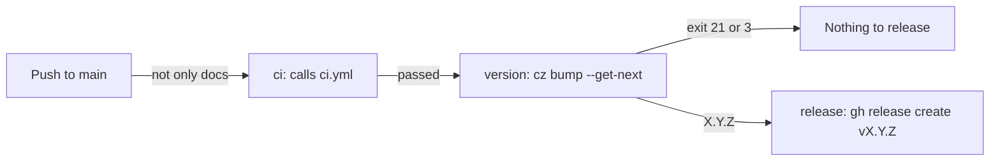

# Releases

How [`.github/workflows/release.yml`](../.github/workflows/release.yml) releases the dotfiles from `main`: when a release is made, how its version is worked out and the tag it creates. It's for engineers changing the workflow or [`.cz.toml`](../.cz.toml).

## Contents

1. [Overview](#overview)
1. [How the version is decided](#how-the-version-is-decided)
1. [Tags and releases](#tags-and-releases)
1. [Security](#security)
1. [Decisions](#decisions)
1. [Limits](#limits)
1. [Sources](#sources)

## Overview

The workflow runs on every push to `main`, except a change only to the docs or agent settings, with the same `paths` filter as [CI](ci.md#overview). This flowchart shows the jobs:

- **`ci`** calls [`ci.yml`](../.github/workflows/ci.yml), so a push straight to `main` is checked as a pull request is, and a failed check releases nothing.
- **`version`** checks out the whole history, installs commitizen and works out the version, as [How the version is decided](#how-the-version-is-decided) describes. It outputs the tag, or no tag when there's nothing to release.
- **`release`** runs only when there's a tag. It checks it's the newest run of the workflow with `gh run list`, then runs `gh release create "$TAG" --target "$GITHUB_SHA" --generate-notes`.

Runs share the `release` concurrency group: a run waits for the one in progress, and a newer push replaces a run that's still waiting, so two releases never race.

## How the version is decided

The `version` job runs `cz bump --get-next --yes` with [commitizen](https://commitizen-tools.github.io/commitizen/) from Ubuntu's archive and the settings in [`.cz.toml`](../.cz.toml). It only prints the version. commitizen reads every line of the commits since the latest `v` tag, which are the squash-merged pull requests' titles and descriptions, and takes the biggest bump any line asks for:

| A line that starts with | Bump before `v1.0.0` | Bump from `v1.0.0` |
| --- | --- | --- |
| Any type with `!` | Minor | Major |
| `feat` | Minor | Minor |
| `fix`, `perf` or `refactor` | Patch | Patch |
| Any other type, such as `docs`, `ci`, `test` or `chore` | None | None |

- When no commit calls for a bump, commitizen exits with code 21, and with code 3 when there are no commits since the tag. The job then outputs no tag, so a change such as a CI fix or a Dependabot `chore(deps)` update is released with the next change that bumps the version.
- `version_provider = "scm"` reads the current version from the latest tag, so no file holds a version. The job checks out the whole history for this.
- `version_scheme = "semver2"` writes any pre-release version the SemVer way, such as `1.0.0-beta.0`.
- `major_version_zero = true` keeps a breaking change to a minor bump before `v1.0.0`. Remove it in the change that moves the project to `v1.0.0`, because commitizen 4.11.0 keeps applying it at `1.x` (observed).
- `--yes` answers the question commitizen asks when there's no tag yet. Without it, the command waits for input (observed).
- The first release is `v0.1.0`. With no tags, commitizen counts from `0.0.0`, and the history's `feat` commits give `0.1.0` (observed with commitizen 4.11.0 on `main`).

## Tags and releases

- Each release is a GitHub release with a `vX.Y.Z` tag on the commit the run came from, and notes GitHub generates from the merged pull requests. It has no assets of its own: GitHub adds the source archives.
- Only the workflow creates release tags. Nobody tags a release by hand, except to move to `v1.0.0`.
- The `release` job only releases from the newest run, because a newer run releases the same changes. That also stops a re-run of an older run tagging an older commit.

## Security

- The workflow's token can only read the repository, except in the `release` job, which has `contents: write` to create the release and its tag, and `actions: read` to list the workflow's runs. That job has no checkout and runs no repository code.
- The `version` job's checkout doesn't keep the token (`persist-credentials: false`).
- Every action is pinned to a full commit SHA, with its version in a comment. Dependabot updates them.

## Decisions

- **The checks in their own workflow.** [CI](ci.md) runs on pull requests and is called from here, so both run the same checks from one file.
- **commitizen from Ubuntu's archive**, as in the WSL user-data's release workflow. It's installed with apt, like the linters.
- **No release without a bump.** A run whose commits are all of a type with no bump, such as `docs` or `chore`, releases nothing, rather than a patch.
- **`gh release create`, not `cz bump`.** With `version_provider = "scm"`, `cz bump` has no file to commit, so it fails before it tags. The release job tags with the GitHub API instead.

## Limits

- The tags the workflow creates aren't signed.

## Sources

- https://commitizen-tools.github.io/commitizen/
- https://docs.github.com/en/actions/sharing-automations/reusing-workflows
- https://cli.github.com/manual/gh_release_create
