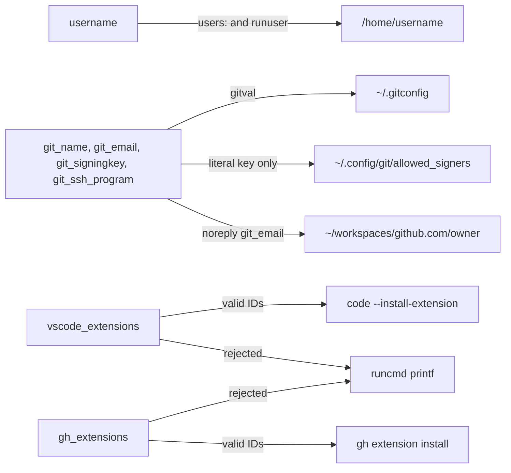
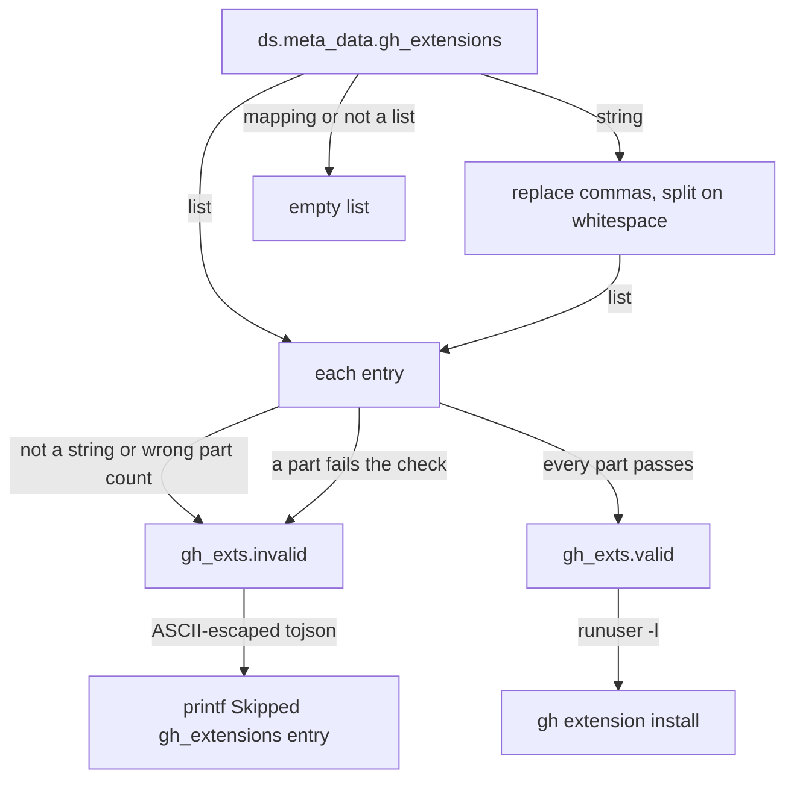

# WSL meta-data

How the WSL user-data reads each key of [`Ubuntu-26.04.meta-data`](../../src/wsl/Ubuntu-26.04.meta-data): how it normalises and validates the value, where the value ends up and how it reports a value it rejects. It's for engineers adding or changing a meta-data key. [WSL provisioning](overview.md) covers the rest of the user-data.

## Contents

1. [Overview](#overview)
1. [Keys](#keys)
1. [How each key is handled](#how-each-key-is-handled)
1. [Reporting rejected values](#reporting-rejected-values)
1. [Security and privacy](#security-and-privacy)
1. [Decisions](#decisions)
1. [Limits](#limits)
1. [Sources](#sources)

## Overview

The meta-data file is a YAML template with the identifying values left empty. The user copies it to `%USERPROFILE%\.cloud-init\Ubuntu-26.04.meta-data`, fills it in and keeps the filled copy out of the repository. cloud-init's WSL datasource reads it, and the Jinja header of [`Ubuntu-26.04.user-data`](../../src/wsl/Ubuntu-26.04.user-data) reads each key as `ds.meta_data.<key> or ''` (or `or []` for a list), so a missing key, an empty value and `null` all count as unset.

The header turns each key into the variables the cloud-config uses. This flowchart shows where each key ends up:



## Keys

Every key apart from `instance-id` needs `username`: without one, the user-data writes no `~/.gitconfig` or other file into a home, and installs nothing as a user.

| Key | Expected type | Shipped value | Ends up in |
| --- | --- | --- | --- |
| `instance-id` | String | `ubuntu-wsl` | Read by the datasource, which needs it. The template doesn't use it |
| `username` | String | Empty | `users:`, every `runuser` command and the home paths |
| `git_name`, `git_email` | String | Empty | `[user]` in `~/.gitconfig` |
| `git_signingkey` | String | Empty | `user.signingkey`, `gpg.format`, `commit.gpgsign`, `gpg.ssh.allowedSignersFile` and `allowed_signers` |
| `git_ssh_program` | String | Empty | `gpg.ssh.program` |
| `vscode_extensions` | List or string | `Anthropic.claude-code`, `ms-python.python` | One `code --install-extension` per ID |
| `gh_extensions` | List or string | `https://github.com/nektos/gh-act` | One `gh extension install` per ID |

## How each key is handled

### `username`

The username isn't validated. It's written as it is into `users:` (uid 1000, `/usr/bin/zsh`, passwordless sudo, locked password), into the `owner` and `path` of the deferred files and into the `runuser` commands. When it's empty, Ubuntu's out-of-box experience asks for a user instead.

### Git identity

`git_name`, `git_email`, `git_signingkey` and `git_ssh_program` go into `~/.gitconfig` through the `gitval` macro. It wraps the value in double quotes and escapes `\` and `"`, so git reads back characters such as `#`, `;` and `'` exactly. It doesn't escape a newline. The `[user]` section is written only when `git_name`, `git_email` or `git_signingkey` is set.

### `git_signingkey` and `allowed_signers`

A string key is trimmed first. Any key that's set turns on signing: `user.signingkey`, `gpg.format = ssh` and `commit.gpgsign = true`.

The user-data also writes `~/.config/git/allowed_signers` and points `gpg.ssh.allowedSignersFile` at it, but only for a key git reads as literal: one that starts with `key::` or `ssh-`. Any other value is a key file path to git, and gets no file. The key must also pass these checks:

- Its type starts with `ssh-`, `ecdsa-` or `sk-` and holds only letters, digits, `-`, `@` and `.`.
- Its data is non-empty and holds only base64 characters.
- Both are ASCII.

The file holds one line, `<principal> namespaces="git" <type> <base64>`, without the key's comment. The principal is `git_email` when it holds only ASCII letters, digits and `.+_@-`, and `*` (any identity) otherwise, including when it's empty.

### GitHub workspace directory

When `git_email` is a GitHub noreply address (the domain `users.noreply.github.com`, in any case), the user-data takes the GitHub username from it: the part after the first `+` in `ID+user@`, or the whole local part of `user@`. If that username holds only letters, digits and `-`, `runcmd` creates `~/workspaces/github.com/<user>` as the user. Any other email creates no directory.

### `vscode_extensions` and `gh_extensions`

Both lists are normalised the same way. This flowchart shows it for `gh_extensions`:



- **`vscode_extensions`:** each entry is a `publisher.name` Marketplace ID. Both parts must start with a letter or digit and hold only ASCII letters, digits and `-`. Each install runs as the user, and exits quietly when `/usr/local/bin/code` isn't executable.
- **`gh_extensions`:** each entry is `owner/repo`, `host/owner/repo` or `https://host/owner/repo`. A URL needs all three parts. Every part must start with a letter or digit and hold only ASCII letters, digits, `.`, `_` and `-`, which rules out `.` and `..`. Each install runs as the user with `runuser -l <user> -c "gh extension install <entry>"`.

Each install is its own `runcmd` entry, so one failure doesn't stop the rest.

## Reporting rejected values

Each rejected list entry gets its own `runcmd` entry that prints why it was skipped:

```text
Skipped vscode_extensions entry, not a publisher.name ID: %s
Skipped gh_extensions entry, not an [https://][host/]owner/repo: %s
```

- The value is the entry's string form, with non-ASCII characters escaped by Python's `backslashreplace` and then quoted by Jinja's `tojson`. A non-string entry, such as `42`, prints as `42`.
- It escapes to ASCII first because `tojson` writes a character outside the Basic Multilingual Plane as a surrogate pair, which YAML decodes into lone surrogates. cloud-init then can't write the `runcmd` script as UTF-8, and every entry fails.
- It uses `printf` with `%s` rather than `echo`, because dash's `echo` interprets backslashes.
- These lines sit inside the template's `` block, so nothing is reported without a username.

## Security and privacy

- The meta-data holds everything identifying. The shipped template keeps those values empty and fills in only generic defaults, the two extension lists.
- Meta-data is the user's own input, but the user-data still treats it as untrusted where it reaches a shell. Only entries that pass the checks above are written into a command, and rejected ones go into `printf` as a quoted argument, not into the command text.
- Values written into `~/.gitconfig` go through `gitval`, so `"`, `\` and comment characters stay inside the value.
- `allowed_signers` trusts the key only in the `git` namespace.

## Decisions

- **Validate in the template, not at runtime.** Checking each value before it's rendered keeps hostile text out of shell commands. The template's comments say only validated IDs reach the shell.
- **Accept a string for a list.** A comma or space-separated string is split into entries, so a list written on one line still works (inferred: no comment gives the reason).
- **Report rather than fail.** A bad entry is skipped and named in the log, so the rest of the instance still builds.
- **Derive the workspace from a noreply email only.** It's the one email form that holds the GitHub username (inferred).
- **`*` as the fallback principal.** It keeps verification working when the email can't be written safely as a principal, at the cost of trusting the key for any identity (inferred: the meta-data comment states the fallback, not the reason).

## Limits

- `username` isn't validated. A value with spaces or YAML syntax breaks the render or the commands (inferred).
- A newline in `git_name`, `git_email` or `git_ssh_program` isn't escaped. In `git_name` it broke the YAML of the rendered user-data (observed).
- A `git_signingkey` that isn't a string, such as a list, is written to `user.signingkey` in its Python form and still turns on signing (observed). It gets no `allowed_signers` file.
- Without `username`, rejected values aren't reported (observed).
- `gh extension install` runs before the user logs in to gh, so a private extension fails at first boot (inferred from the comment that a public one needs no login).
- A VS Code extension install is skipped without a message when `/usr/local/bin/code` isn't executable, such as when VS Code isn't installed at the linked Windows path.

## Sources

- https://cloudinit.readthedocs.io/en/latest/reference/datasources/wsl.html
- https://cloudinit.readthedocs.io/en/latest/explanation/instancedata.html
- https://cli.github.com/manual/gh_extension_install
- https://git-scm.com/docs/git-config
