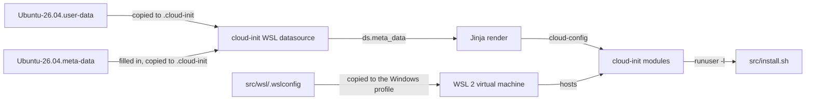
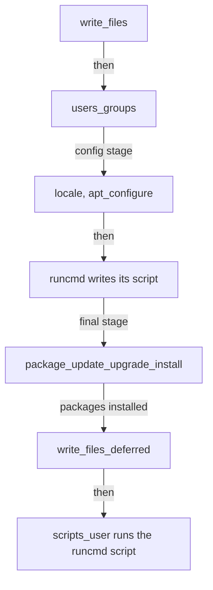
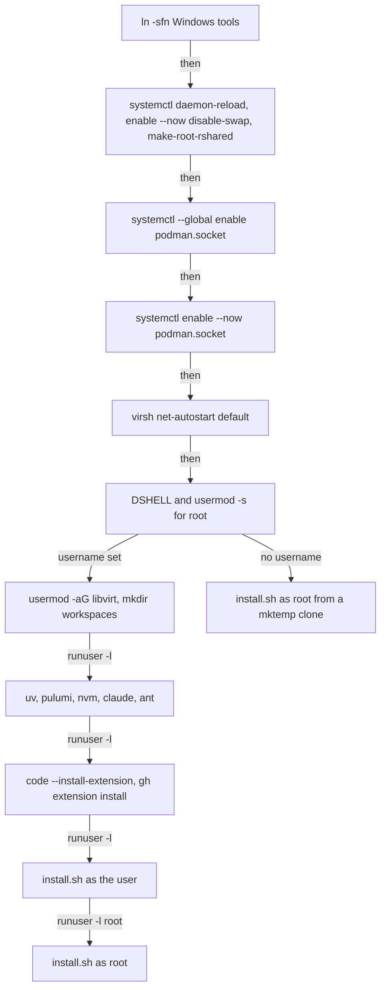

# WSL provisioning

How the files in [`src/wsl/`](../../src/wsl/) build an Ubuntu 26.04 WSL instance from scratch on its first boot. It's for engineers changing `.wslconfig` or the cloud-init user-data. The meta-data keys have their own doc, [WSL meta-data](meta-data.md).

## Contents

1. [Overview](#overview)
1. [How it works](#how-it-works)
1. [Interfaces](#interfaces)
1. [Errors and logging](#errors-and-logging)
1. [Security and privacy](#security-and-privacy)
1. [Decisions](#decisions)
1. [Validation](#validation)
1. [Limits](#limits)
1. [Sources](#sources)

## Overview

`src/wsl/` holds three files that the user copies to their Windows profile. Nothing in the repository copies them:

| File | Copied to | Role |
| --- | --- | --- |
| [`.wslconfig`](../../src/wsl/.wslconfig) | `%USERPROFILE%\.wslconfig` | Settings for the WSL 2 virtual machine, shared by every instance |
| [`Ubuntu-26.04.user-data`](../../src/wsl/Ubuntu-26.04.user-data) | `%USERPROFILE%\.cloud-init\Ubuntu-26.04.user-data` | The Jinja cloud-config. Generic, and the same for every user |
| [`Ubuntu-26.04.meta-data`](../../src/wsl/Ubuntu-26.04.meta-data) | `%USERPROFILE%\.cloud-init\Ubuntu-26.04.meta-data` | A template the user fills in with their identity and choices. See [WSL meta-data](meta-data.md) |

The user-data installs packages, writes system config, bridges Windows tools into Linux, creates the user and runs the dotfiles' [`install.sh`](../../src/install.sh) for that user and for root. It holds nothing personal: every personal value comes from the meta-data.

This flowchart shows how the files reach the instance:

## How it works

### Finding the files

cloud-init's WSL datasource loads one user-data file, picked by instance name first, and only `<Instance>.meta-data`, which must contain `instance-id`. Both files are named for `Ubuntu-26.04`, the default name `wsl --install Ubuntu-26.04` gives. A test instance installed with `--name ci-test` needs copies named `ci-test.user-data` and `ci-test.meta-data`. The datasource merges nothing except Ubuntu Pro's `agent.yaml`.

cloud-init runs once, on first boot, and Ubuntu's out-of-box experience (OOBE), `/usr/lib/wsl/wsl-setup`, waits for it.

### Rendering

The first line, `## template: jinja`, makes cloud-init render the file with Jinja before it parses the YAML. The header block reads every meta-data key from `ds.meta_data`, normalises and validates it and sets the variables the rest of the file uses. [WSL meta-data](meta-data.md) describes each one. It also builds paths with the `workspace` macro, which turns a clone URL into `workspaces/<host>/<owner>/<repo>`, so this repository's clone lands in `~/workspaces/github.com/froazin/dotfiles`.

Jinja runs with `trim_blocks` on and `lstrip_blocks` off, so every `` and `{# #}` tag sits at column 0. An indented tag would leave its indentation behind and break the YAML.

### Stages

cloud-init runs its modules in a fixed order, not in the order the keys appear in the file. This flowchart shows the modules the user-data uses, in the order Ubuntu's `/etc/cloud/cloud.cfg` lists them (observed):

- **Init stage:** `write_files` writes the system files, then `users` creates the user with uid 1000, zsh, passwordless sudo and a locked password.
- **Config stage:** `locale` sets `en_GB.UTF-8` and apt adds the GitHub CLI source and its key. The `runcmd` module then writes the commands out as a script.
- **Final stage:** apt updates, upgrades and installs `packages`. The deferred files go into the user's home. The `runcmd` script runs last.

Anything that needs a package, or a group a package creates such as `libvirt`, is in `runcmd` or a deferred file. The files in the user's home are deferred because `write_files` runs before `users_groups` creates the user.

### System files

| Path | Why |
| --- | --- |
| `/etc/wsl.conf` | Turns on systemd, remounts `/` shared at boot and keeps the Windows `PATH` out (`appendWindowsPath=false`). Has no `[user]` section, because the OOBE writes `default=` |
| `/etc/apt/preferences.d/github-cli` | Pins `gh` from `cli.github.com` at 600, above the 510 Ubuntu Pro gives ESM |
| `/etc/adduser.conf` (appended) | Adds a user the OOBE creates to `users`, `kvm` and `libvirt` |
| `/etc/containers/nodocker` | Stops `podman-docker`'s `docker` wrapper printing its "Emulate Docker CLI using podman" notice |
| `/etc/profile.d/browser.sh`, `/etc/environment.d/90-browser.conf` | Set `BROWSER=/usr/local/bin/start` |
| `/etc/systemd/system/disable-swap.service` | Runs `swapoff -a`, because WSL attaches swap before systemd starts, even with `swap=0` |
| `/etc/systemd/system/make-root-rshared.service` | Runs `mount --make-rshared /` before `sysinit.target`, backing up the `[boot]` command podman needs |
| `/etc/systemd/user/podman.socket.d/10-not-root.conf` | `ConditionUser=!root`, so root's user manager doesn't start a second rootful podman API |
| `/usr/local/bin/start` | Opens a URL or file with its Windows handler through PowerShell `Start-Process`. Used as `$BROWSER` |

With a username, two deferred files go into the user's home: `~/.gitconfig` and `~/.config/git/allowed_signers`. [WSL meta-data](meta-data.md) says when each is written.

### runcmd

cloud-init writes `runcmd` out as one `#!/bin/sh` script with no `set -e`, so each entry runs whatever the others return. The order still matters:

- The global `podman.socket` enable comes before the first `runuser -l`. That entry starts the user's systemd manager, which reads global wants only when it starts.
- `DSHELL=/usr/bin/zsh` and root's `usermod -s` run only when `/usr/bin/zsh` is executable, so a failed package install can't leave a login shell that doesn't exist. Root's shell is set before root's install, so the zsh module's `$SHELL` check sees zsh and doesn't warn.
- The user's install puts `~/.local/bin` and `~/.pulumi/bin` on `PATH` itself, because `~/.zshenv` doesn't exist yet. Without that, `install.sh` can't find `claude` and skips the claude module.
- Root's install uses the absolute path `/home/<user>/workspaces/...`, because `~` under `runuser -l root` is `/root`.
- Without a username, root's copy comes from a shallow clone in a `mktemp -d` directory, which is deleted afterwards.

## Interfaces

- **Windows tools:** `runcmd` links `code`, `op`, `ssh`, `ssh-add` and `clip` from fixed paths under `/mnt/c/` into `/usr/local/bin/`. A link to a missing program is left dangling.
- **The dotfiles:** the user-data expects [`src/install.sh`](../../src/install.sh) at a fixed path in this repository, and `~/.zshenv` from the [zsh module](../zsh/overview.md) to put `~/.local/bin` and `~/.pulumi/bin` on `PATH` later. `~/.zshenv` also exports `BROWSER=/usr/local/bin/start` when that file is executable.
- **Workspaces:** `~/workspaces/<host>/<owner>/<repo>` is the layout the zsh `ws` picker reads. The user-data clones nvm and this repository there.

## Errors and logging

- One bad name in `packages` fails the whole package install. `qemu-kvm` is a virtual package and isn't listed for that reason.
- A failing `runcmd` entry doesn't stop the rest. Each VS Code and gh extension has its own entry for this reason.
- Rejected meta-data values are reported with `printf` lines in `runcmd`, as [WSL meta-data](meta-data.md#reporting-rejected-values) describes. They go to cloud-init's output log (inferred).
- `install.sh` logs as described in the [installer doc](../installer.md), and exits non-zero when a module fails.

## Security and privacy

- The repository is public. The user-data holds no personal usernames, emails, signing keys, hostnames or `/mnt/c/Users/<name>/` paths: they come from the user's private meta-data. The only account name in it is this repository's own URL.
- Only validated meta-data values reach shell commands. `username` is the exception: it's trusted as written (see [WSL meta-data](meta-data.md#limits)).
- The GitHub CLI apt key is embedded in the file, with its fingerprint in a comment, rather than fetched at boot.
- `uv`, `pulumi`, Claude Code and `ant` are fetched over HTTPS and run as the user. Their integrity rests on those hosts and TLS.
- `/usr/local/bin/start` passes its target to PowerShell in an environment variable through `WSLENV`, never in the command, so the target is never parsed as code.
- The user named by `username` gets passwordless sudo, and their password is locked.

## Decisions

- **Native cloud-init modules over custom scripts.** Files, users, apt sources and packages use their modules. `runcmd` holds only what has no module.
- **Installers run as the user** with `runuser -l`, so the tools live in the user's home and update themselves. nvm is cloned and checked out at its newest tag, and `ant` is unpacked with `tar -m` so zsh notices the new binary and regenerates its completion.
- **`systemctl --global` instead of `--user`.** `runcmd` has no user bus. The `ConditionUser=!root` drop-in keeps the global enable out of root's user manager, which `sudo su` starts.
- **Root's shell through `usermod`.** `users:` skips existing users, root included, and would lock root's password.
- **Windows tools by link, not the Windows `PATH`.** With the Windows `PATH` appended, `xdg-open` finds `explorer.exe` and bypasses `$BROWSER`. The links bring in only the five tools listed.
- **`WSL_DISTRO_NAME` from `wslpath`.** VS Code's launcher installs into `~/.vscode-server` only when it's set, and `runuser` clears it. The value only labels the remote.
- **No `power_state` or `package_reboot_if_required`.** They restart the instance in the middle of the OOBE. The README tells the user to restart it with `wsl --terminate` once cloud-init finishes instead.

## Validation

[`validate.sh`](../../.claude/skills/validate-wsl-user-data/scripts/validate.sh) renders the template with `cloud-init devel render` against mock meta-data, runs `cloud-init schema` on each result and checks it. Its cases and checks are listed in the [validate-wsl-user-data skill](../../.claude/skills/validate-wsl-user-data/SKILL.md). Add a case for every new meta-data key or conditional, including the key being unset.

It doesn't prove a real first boot. Only a throwaway instance, as the README describes, exercises the datasource, the OOBE and the package installs.

## Limits

- `.wslconfig` holds fixed values, such as `processors=12` and `memory=32GB`, and applies to every WSL 2 instance on the machine. Another machine may need different values.
- The user-data runs once. Changing it doesn't change an existing instance.
- The Windows tool paths are fixed. A tool installed elsewhere gets a dangling link.
- `ant`'s architecture is chosen only for `x86_64` and `aarch64`.
- Without a username, the user the OOBE creates gets zsh and the groups, but none of the tools, extensions or dotfiles. The README lists the commands to finish it.

## Sources

- https://cloudinit.readthedocs.io/en/latest/reference/datasources/wsl.html
- https://cloudinit.readthedocs.io/en/latest/explanation/instancedata.html
- https://cloudinit.readthedocs.io/en/latest/reference/modules.html
- https://learn.microsoft.com/en-us/windows/wsl/wsl-config
