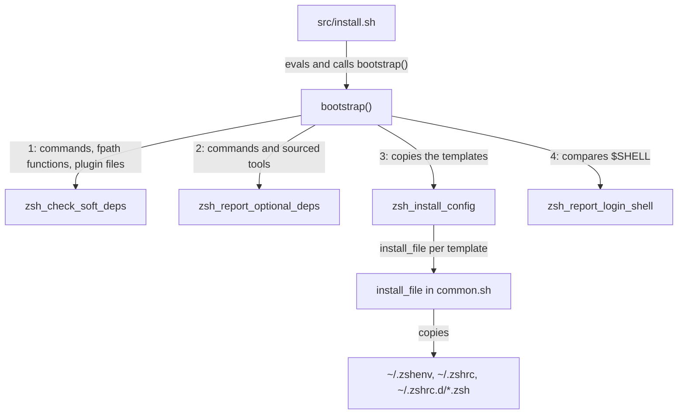
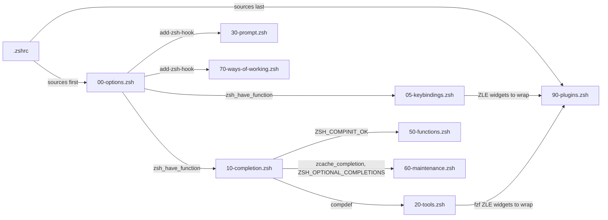

# zsh module

How the `zsh` module installs its configuration and how that configuration loads, for engineers changing anything under [src/modules/zsh/](../../src/modules/zsh/). The first-login setup of a ways-of-working repository has its own doc, [Ways-of-working setup](ways-of-working-setup.md).

## Contents

1. [Responsibilities](#responsibilities)
1. [How it installs](#how-it-installs)
1. [How it loads](#how-it-loads)
1. [Completion registry](#completion-registry)
1. [Root](#root)
1. [Errors and logging](#errors-and-logging)
1. [Security and privacy](#security-and-privacy)
1. [Decisions](#decisions)
1. [Limits](#limits)
1. [Sources](#sources)

## Responsibilities

- [bootstrap.sh](../../src/modules/zsh/bootstrap.sh) copies the templates into `$HOME` and reports which dependencies are missing. The [installer](../installer.md) runs it only when `zsh` is on `PATH`.
- The templates configure the shell at runtime: `PATH`, editor, prompt, completion, keybindings, aliases, the `ws` workspace picker, maintenance commands and plugins.
- It never runs `chsh`. It only warns when `$SHELL` isn't zsh. The WSL user-data sets the login shells (see [WSL provisioning](../wsl/overview.md)).
- It doesn't install packages. The templates check for each tool at runtime and skip what's missing, so a missing tool doesn't stop the shell starting.

## How it installs

`bootstrap()` runs four steps and returns 1 if any of them failed. Every step runs, even when an earlier one failed.

- **Soft dependencies** (`ZSH_SOFT_DEPS`, `ZSH_SOFT_FUNCTIONS`, `ZSH_SOFT_PLUGINS`): the commands `fzf` and `git`, the two plugin files under `/usr/share` and the zsh functions `vcs_info`, `compinit` and `add-zsh-hook`. Each missing one logs an error and makes the module fail, but the files are still installed.
- **Functions** are found by `zsh_have_function`, which runs `zsh -f` and globs each `$fpath` entry for the name. That's how it detects the `zsh-common` package without asking a package manager.
- **Optional dependencies** (`ZSH_OPTIONAL_DEPS`, `ZSH_OPTIONAL_SOURCED`): `op`, `uv`, `pulumi`, `direnv`, `ant`, `podman`, `xdg-open` and `gh`. nvm is listed as `name:file` (`nvm:${NVM_DIR:-$HOME/.nvm}/nvm.sh`). A missing one logs a warning, or a debug message when `is_root`.
- **Templates** are found from `$(dirname "$0")`, which is `src/` because the installer evaluates the module into its own shell. Every `templates/.zshrc.d/*.zsh` is installed, so a new drop-in needs no change to `bootstrap.sh`.

When a template starts depending on a new tool, update the lists in `bootstrap.sh`, the README dependency table and, for an apt package, `packages` in the WSL user-data.

## How it loads

zsh reads [.zshenv](../../src/modules/zsh/templates/.zshenv) in every shell, including scripts. It sets `skip_global_compinit`, `path` (with `~/.local/bin`, `~/bin` and `~/.pulumi/bin` first and `/snap/bin` last), `XDG_DATA_DIRS` for snap desktop files, `EDITOR` and `VISUAL`, `BROWSER` (when a Windows bridge exists), `LIBVIRT_DEFAULT_URI`, `GCC_COLORS` and `VIRTUAL_ENV_DISABLE_PROMPT`. It also sets `DOCKER_HOST` and `REGISTRY_AUTH_FILE` for podman, each only when unset and `podman` is installed (see [podman module](../podman-module.md)).

Interactive shells then read [.zshrc](../../src/modules/zsh/templates/.zshrc), which only sources `~/.zshrc.d/*.zsh(N)` in name order. Each topic lives in one drop-in:

| Drop-in | Holds |
| --- | --- |
| [00-options.zsh](../../src/modules/zsh/templates/.zshrc.d/00-options.zsh) | Shell options, `zsh_have_function`, an `add-zsh-hook` fallback, in-memory history |
| [05-keybindings.zsh](../../src/modules/zsh/templates/.zshrc.d/05-keybindings.zsh) | Emacs keymap, Windows-style word editing, <kbd>Ctrl</kbd>+<kbd>X</kbd> <kbd>Ctrl</kbd>+<kbd>E</kbd>, <kbd>Alt</kbd>+<kbd>H</kbd> for `run-help` |
| [10-completion.zsh](../../src/modules/zsh/templates/.zshrc.d/10-completion.zsh) | `fpath`, the [completion registry](#completion-registry), `compinit`, completion styles |
| [20-tools.zsh](../../src/modules/zsh/templates/.zshrc.d/20-tools.zsh) | The `direnv` hook, fzf key bindings and completion, nvm |
| [30-prompt.zsh](../../src/modules/zsh/templates/.zshrc.d/30-prompt.zsh) | The prompt, its `vcs_info` git segment and the window title |
| [40-aliases.zsh](../../src/modules/zsh/templates/.zshrc.d/40-aliases.zsh) | Colour aliases for `ls` and `grep`, `browse` and `alert` |
| [50-functions.zsh](../../src/modules/zsh/templates/.zshrc.d/50-functions.zsh) | The `workspaces` picker, its aliases `ws` and `workspace`, `wsc` and `_ws` |
| [60-maintenance.zsh](../../src/modules/zsh/templates/.zshrc.d/60-maintenance.zsh) | `zshup` and `zshreload` |
| [70-ways-of-working.zsh](../../src/modules/zsh/templates/.zshrc.d/70-ways-of-working.zsh) | `wow-setup` (see [Ways-of-working setup](ways-of-working-setup.md)) |
| [90-plugins.zsh](../../src/modules/zsh/templates/.zshrc.d/90-plugins.zsh) | zsh-autosuggestions and zsh-syntax-highlighting |

The order matters because later drop-ins use what earlier ones define. This diagram shows the main dependencies, including the Zsh Line Editor (ZLE) widgets the plugins wrap:

- Anything that registers ZLE widgets loads before `90-plugins.zsh`, because zsh-syntax-highlighting has to follow every widget.
- Anything that calls `compdef` loads after `10-completion.zsh` and checks first that `compinit` ran, such as nvm's `bash_completion` and `_ws`.
- `compinit` runs with `-C`, which skips its checks, only while `$ZSH_COMPDUMP` is under a day old. Otherwise it runs in full and `touch -c` restarts the day.
- The prompt is a native zsh port of the devcontainers `common-utils` theme. `vcs_info` never checks for changes and is disabled under `/mnt`. A repository opts in with `git config zsh-theme.show-dirty 1` or hides the segment with `git config zsh-theme.hide-status 1`, and `_zp_repo_cfg` caches both on the config file's modification time.
- `ws` lists directories exactly three levels below `${WORKSPACE_DIR:-${SUDO_HOME:-$HOME}/workspaces}`, which is the `<host>/<owner>/<repo>` layout, and picks one with fzf.

## Completion registry

`ZSH_OPTIONAL_COMPLETIONS` in `10-completion.zsh` maps a tool to the command that prints its zsh completion: `uv`, `uvx`, `op`, `pulumi` and `ant`. Add a tool there, and both startup and `zshup` pick it up.

`zcache_completion` writes `_<name>` into `ZSH_COMPLETION_DIR` (`~/.local/share/zsh/site-functions`, first on `fpath`). It returns:

| Status | Meaning |
| --- | --- |
| `0` | Regenerated |
| `1` | Already current: the file is no older than the tool's binary |
| `2` | The tool isn't installed |
| `3` | Generation failed, or failed before for this same binary |

- Without `-f`, it regenerates only when the file is missing or the binary is newer than it, so an update to a tool refreshes its completion on the next shell.
- A failure leaves a marker in `.failed/<name>`, outside `fpath`. Startup doesn't retry until the binary changes, and `zshup` forces a retry with `-f`.
- The generator runs in `ZSH_COMPLETION_DIR`, so a tool that reads its working directory never acts on the project the shell opened in. Apache Ant parsing `./build.xml` is the case the code names.
- An optional `_zcache_patch_<name>` function edits the generated file. `_zcache_patch_uv` makes `uv run` complete the project's commands through `_uv_run_command`.
- `zshup` regenerates every entry and, when `compinit` is available, deletes and rebuilds the dump. Then it tells you to run `exec zsh` (aliased as `zshreload`).

## Root

Root gets its own copy of these files when the installer runs as root, as the WSL user-data does, and root shells such as `sudo su` and `sudo -i` load them. The templates check `EUID` for anything that mustn't run as root, and never trust `$SHELL` to name the running shell:

- `EDITOR` is `code --wait` only when `code` is on `PATH` and the shell is a user's, or root's inside a dev container (`REMOTE_CONTAINERS=true`). Otherwise it's `vim`, then `vi`. `ws -c` follows the same rule.
- `DOCKER_HOST` points at `/run/podman/podman.sock` for root and at the user's socket otherwise, and only when the socket exists and the shell's user owns it.
- The prompt's dirty marker and the `ws` preview run `git status` only in repositories root owns, because git can run programs a repository's config names.
- `ws` finds the invoking user's workspaces through `$SUDO_HOME`.
- `wow-setup` never runs on its own as root.
- The window title uses `$ZSH_NAME`, because under `sudo -s` `$SHELL` is root's login shell.

## Errors and logging

- `bootstrap.sh` logs through `log` from [logging.sh](../../src/internal/logging.sh) (see [Installer](../installer.md)). A missing soft dependency is an error and an optional one a warning (a debug message for root). The messages say the shell still works, or that the tool's integration stays dormant until it's installed.
- `install_file` warns before it overwrites a file that differs, and fails, leaving the file alone, when the destination is a symbolic link. A failed copy or a link makes `zsh_install_config` fail, after it has tried every template.
- At runtime the templates skip a missing tool without a message. The exception is `wow-setup`, which says so when it needs `git` to clone (see [Ways-of-working setup](ways-of-working-setup.md#errors-and-logging)). Commands the user runs, such as `ws`, print their errors to standard error and return non-zero.

## Security and privacy

- History lives in memory only: `SAVEHIST=0` and `HISTFILE` is unset, so no command line is written to disk.
- Root's files are copies, so a process running as the user can't change what root's shell runs.
- `_zp_title` and `alert` print the command line without `print -P`, because under `prompt_subst` that would run any `$(...)` in it. The title also blanks control characters.

## Decisions

- **Copies, not links.** Installing copies keeps root's configuration out of the user's reach. The cost is that you rerun the installer after pulling changes.
- **Probe `$fpath`, not a package manager.** The function check works on any distribution (inferred).
- **Graded dependencies.** The config is always installed, so a tool installed later works in the next shell without a reinstall.
- **Generated completions are cached.** Running every generator on each startup would slow it down (inferred), so the cache is keyed on the binary's modification time.
- **The dirty marker is opt-in per repository.** `git status` is slow in large repositories and on 9p mounts (inferred), so the prompt shows only the branch by default.

## Limits

- The installer never deletes a drop-in. One renamed or removed in the repository stays in `~/.zshrc.d/`, and `.zshrc` still sources it.
- A symbolic link at a destination is never replaced, and the module reports failure until you remove it.
- The plugin paths are the Debian and Ubuntu ones under `/usr/share`. Elsewhere the plugins don't load.
- fzf 0.48 or later loads through `fzf --zsh`. Older versions load the Debian example scripts, if they're there.
- The module has no automated tests. The checks `CLAUDE.md` lists run `zsh -n` on each template and ShellCheck and shfmt on `bootstrap.sh`. Its end-to-end install into a scratch home runs `bootstrap()`.

## Sources

- https://zsh.sourceforge.io/Doc/Release/Files.html
- https://zsh.sourceforge.io/Doc/Release/Completion-System.html
- https://zsh.sourceforge.io/Doc/Release/Functions.html
