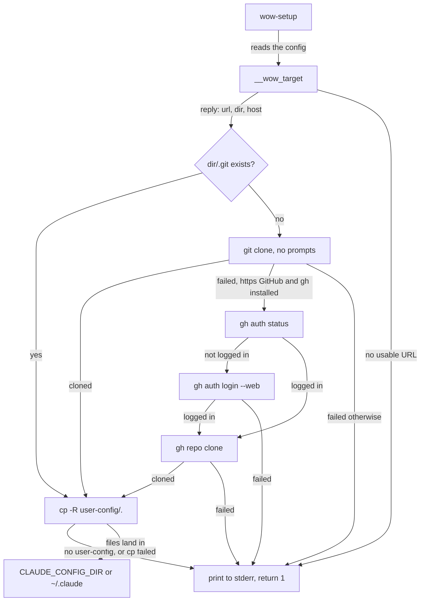

# Ways-of-working setup

How the zsh configuration clones a user's ways-of-working repository on their first login and copies its `user-config/` into `~/.claude`. It's for engineers changing [70-ways-of-working.zsh](../../src/modules/zsh/templates/.zshrc.d/70-ways-of-working.zsh), or the WSL user-data that configures it.

## Contents

1. [Responsibilities](#responsibilities)
1. [How it works](#how-it-works)
1. [Interfaces](#interfaces)
1. [Errors and logging](#errors-and-logging)
1. [Security and privacy](#security-and-privacy)
1. [Decisions](#decisions)
1. [Limits](#limits)
1. [Sources](#sources)

## Responsibilities

A ways-of-working repository holds a user's shared working practices, with a `user-config/` directory that belongs in `~/.claude`. The drop-in:

- reads the repository's clone URL from a config file;
- clones it once, into the `~/workspaces/<host>/<owner>/<repo>` layout that `ws` lists (see [zsh module](overview.md#how-it-loads));
- logs in with the GitHub CLI (`gh`) when a private GitHub repository needs it;
- copies `user-config/` into the Claude Code config directory.

It doesn't pull updates, and it doesn't write the config file. The WSL user-data writes that file from the meta-data's `ways_of_working` key (see [Meta-data](../wsl/meta-data.md)), or the user writes it by hand.

## How it works

When `.zshrc` sources the drop-in, it adds `__wow_first_login` as a `precmd` hook if all of these hold:

- `EUID` isn't 0;
- standard input and standard output are terminals;
- the config file is readable;
- `__wow_target` fails, or the target has no `.git` directory yet.

The hook removes itself from `precmd_functions` and calls `wow-setup`, so it runs once per shell, before the first prompt. Until a clone exists, every new shell runs it again.

This flowchart shows what `wow-setup` does:

### Parsing the URL

`__wow_target` reads the first line of the config file. It sets `reply` to the URL, the clone directory and the host, or fails. It accepts three forms:

| Form | Example |
| --- | --- |
| `https://host/owner/repo` and other `scheme://` URLs | `https://github.com/OWNER/ways-of-working.git` |
| `ssh://[user@]host[:port]/owner/repo` | `ssh://git@github.com/OWNER/ways-of-working` |
| `[user@]host:owner/repo` | `git@github.com:OWNER/ways-of-working.git` |

- It drops any user and port from the host, and a trailing `/` and `.git` from the path.
- The result must be exactly three parts, `<host>/<owner>/<repo>`, each matching `[A-Za-z0-9._-]##` and none of them `.` or `..`.
- The clone directory is `${WORKSPACE_DIR:-$HOME/workspaces}/<host>/<owner>/<repo>`.
- A last line with no newline still counts (observed).

### Cloning

- `wow-setup` refuses to clone over a path that exists but has no `.git`, and stops if `git` isn't installed.
- It first runs `git clone --quiet` with `GIT_TERMINAL_PROMPT=0`, so git fails instead of asking for a password.
- It falls back to `gh` only for an `https://` URL on `github.com` or `$GH_HOST`, when `gh` is installed. Otherwise it prints git's error.
- The fallback logs in with `gh auth login --hostname <host> --git-protocol https --web` when `gh auth status` fails, then runs `gh repo clone`, which passes gh's own credentials to git.

### Copying

- `wow-setup` needs `<dir>/user-config`, and fails without it.
- It creates `${CLAUDE_CONFIG_DIR:-$HOME/.claude}` with mode `0700` when it's missing, as the [claude module](../claude/overview.md) does.
- `cp -R -- <dir>/user-config/. <claude_dir>/` copies the directory's contents, overwriting files with the same name and keeping every other file.

## Interfaces

| Name | Kind | Use |
| --- | --- | --- |
| `${XDG_CONFIG_HOME:-$HOME/.config}/ways-of-working/repo` | File | The clone URL, on its first line |
| `wow-setup` | Function | Clones if needed, then copies. Returns 1 on any failure. Run it again after a `git pull` to copy the changes |
| `WORKSPACE_DIR` | Environment | The root of the clone directory, `~/workspaces` by default |
| `CLAUDE_CONFIG_DIR` | Environment | Where `user-config/` goes, `~/.claude` by default |
| `GH_HOST` | Environment | A GitHub host, besides `github.com`, that may use the gh fallback |

`__wow_config`, `__wow_target` and `__wow_first_login` are internal to the drop-in.

## Errors and logging

- Every message of its own starts with `wow-setup:`. Progress goes to standard output and errors to standard error. Nothing is logged to a file.
- A failed `git clone` prints git's own error first. A failed `mkdir` of the config directory prints only `mkdir`'s error.
- With an unreadable config, `wow-setup` says no repository is configured. With an unusable URL, it asks for one ending in `<host>/<owner>/<repo>`.
- A failed clone or login ends with the same hint: open a new shell or run `wow-setup` to try again, or delete the config file to stop.
- Paths in messages show `$HOME` as `~`.

## Security and privacy

- It never runs on its own as root, so a root shell doesn't clone into root's home or write root's Claude Code config.
- The automatic run needs a terminal on both standard input and output. VS Code's environment probe is an interactive shell without one, so it never blocks on a login there.
- Checking each path part keeps the clone directory inside the workspaces directory, so a URL can't name `..` or an absolute path.
- `GIT_TERMINAL_PROMPT=0` keeps git from asking for a password in the terminal. When a login is missing, `gh auth login` asks for it in the browser.
- The Claude Code config directory is created owner-only, because it holds credentials too.
- The WSL user-data writes the config file only from a single word of printable ASCII, and the drop-in checks the URL's shape again.

## Decisions

- **A `precmd` hook, not a call during startup.** `wow-setup` runs once `.zshrc` has loaded, so <kbd>Ctrl</kbd>+<kbd>C</kbd> during a clone or login can't cut the shell's startup short.
- **Retry until the clone exists.** A failed setup asks again in each new shell, so a user who was offline or not logged in doesn't need to remember to run it (inferred). Deleting the config file stops it.
- **git first, gh only as a fallback.** A public repository, or one the user's git credentials already reach, clones without gh. The browser login is only for a private GitHub repository on a new machine.
- **Copy, not link.** `user-config/` is copied, so later changes in the clone don't reach `~/.claude` until the user runs `wow-setup`.
- **The `ws` layout.** Cloning to `<host>/<owner>/<repo>` puts the repository where `ws` finds it.

## Limits

- It never pulls. After the first clone, the user runs `git pull` and `wow-setup` themselves.
- Files removed from `user-config/` stay in `~/.claude`.
- Paths with more than three parts, such as a GitLab subgroup (`host/group/subgroup/repo`), are rejected (observed).
- The gh fallback covers only `https` URLs on `github.com` or `$GH_HOST`. An `ssh` URL that fails to clone reports git's error and stops.
- The clone directory ignores `$SUDO_HOME`, unlike `ws`. That's harmless while it never runs as root.
- There are no automated tests. The URL forms in [Parsing the URL](#parsing-the-url) were checked by hand in a throwaway home.

## Sources

- https://zsh.sourceforge.io/Doc/Release/Functions.html#Hook-Functions
- https://git-scm.com/docs/git#Documentation/git.txt-GITTERMINALPROMPT
- https://cli.github.com/manual/gh_auth_login
- https://cli.github.com/manual/gh_repo_clone
