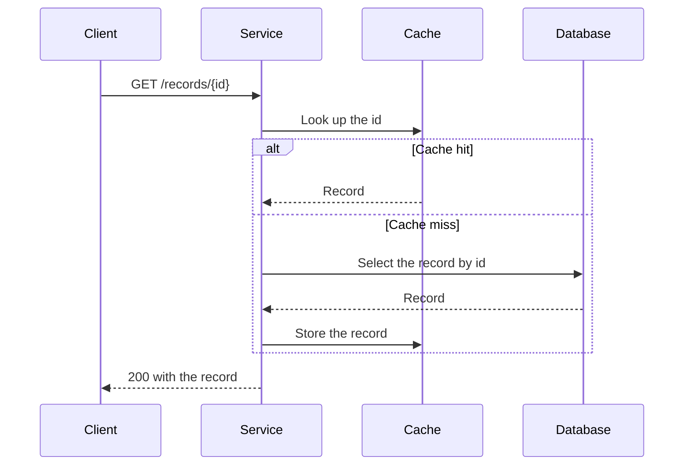

# Diagrams

How to draw diagrams in a project: always in Mermaid, with the diagram type that fits, validated before you commit. It covers docs, READMEs, wiki pages, issues and pull request (PR) descriptions. **Load before you add or change a diagram.** These are house defaults: where a project's `CLAUDE.md` sets other diagram rules, follow the project.

## Use Mermaid

- Draw every diagram as a ```` ```mermaid ```` fenced code block. GitHub renders Mermaid in files, issues, PRs, discussions and wikis.
- Don't use images of diagrams, ASCII art or another diagram language such as PlantUML or Graphviz. GitHub doesn't render them as diagrams, and an image can't be reviewed in a diff.
- A directory tree is the exception: write it as a `text` code block.
- Add a diagram wherever structure, flow, sequence or state is easier to see than to read. Every design doc has at least one (load the wow-repo-docs skill).

## Pick the type

Use any diagram type Mermaid documents. Pick the one that matches what you're showing:

| To show | Type | Keyword |
| --- | --- | --- |
| How components, services or packages fit together | Architecture, C4 or block | `architecture-beta`, `C4Context`, `C4Container`, `C4Component`, `block-beta` |
| Control flow, decision logic or a pipeline | Flowchart | `flowchart` |
| Messages between components over time, such as a protocol | Sequence | `sequenceDiagram` |
| A lifecycle or state machine | State | `stateDiagram-v2` |
| Types, interfaces and how they relate | Class | `classDiagram` |
| A data model or stored records | Entity relationship | `erDiagram` |
| A wire format or byte layout | Packet | `packet-beta` |
| Branches, merges and tags | Git graph | `gitGraph` |
| A plan, schedule or history | Gantt or timeline | `gantt`, `timeline` |
| Requirements and what satisfies them | Requirement | `requirementDiagram` |
| A breakdown of ideas | Mind map | `mindmap` |
| A user's steps through a task | User journey | `journey` |
| Work by status | Kanban | `kanban` |
| Values, proportions or flows of quantity | Pie, XY chart, quadrant, Sankey, radar or treemap | `pie`, `xychart-beta`, `quadrantChart`, `sankey-beta`, `radar-beta`, `treemap-beta` |

- Check the keyword and syntax in [Mermaid's syntax docs](https://mermaid.js.org/intro/) before you use a type for the first time. Mermaid marks its newer types as new, and many of their keywords end in `-beta`.
- GitHub renders Mermaid with its own version, which can be older than Mermaid's docs. GitHub's docs say to check the version by rendering a `mermaid` block that holds only `info`. A type or syntax newer than that version shows an error instead of a diagram.
- Before you commit a `-beta` type or other new syntax, check that it renders on GitHub, for example in the PR's rendered view of the file.

## Validate every diagram

- If a Mermaid MCP server is connected in the session, you **must** validate every diagram you add or change with it before you commit. For example, Mermaid Chart's server has a `validate_and_render_mermaid_diagram` tool.
- Pass it the exact contents of the code block, without the fence. Fix every error and validate again until it passes.
- Read the `valid` field of the result. The result also holds the rendered SVG, which can be too large to read whole (observed).
- The server can use a different Mermaid version from GitHub (inferred), so passing doesn't prove that GitHub renders it. Check new syntax on GitHub as well.
- If no Mermaid MCP server is connected, tell the user when you finish, and list the diagrams you couldn't validate.

## Keep diagrams readable

- Show one idea per diagram. Split a diagram that needs more than about 15 nodes.
- Use the real names of packages, types, files and services as labels, so a reader can find them in the code.
- Label every edge with what passes along it or why.
- Give every diagram an `accTitle` and an `accDescr`, and introduce it with a sentence that says what it shows. Screen readers and the raw Markdown view then still carry its meaning.
- Don't set colours, themes, styles or `%%{init}%%` options, so the diagram stays readable in light and dark themes.
- Write the text in the diagram in the house style (load the wow-writing-style skill).
- Keep the diagram next to the text it illustrates, and change both in the same commit.

## Example

This sequence diagram shows a service that reads through a cache:

````markdown

````

## Checklist

Before you commit a diagram, check that:

- It's a `mermaid` code block of the type that fits.
- It passed the Mermaid MCP server, or you've told the user that it wasn't validated.
- Any `-beta` type or new syntax renders on GitHub.
- It has an `accTitle`, an `accDescr` and an introductory sentence.
- It has no colours, themes or `%%{init}%%` options.

## Sources

- https://docs.github.com/en/get-started/writing-on-github/working-with-advanced-formatting/creating-diagrams
- https://mermaid.js.org/intro/
- https://mermaid.js.org/config/accessibility.html
