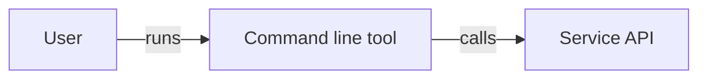

# Markup

What GitHub's wiki renders in `.md` pages, what it doesn't, and how to convert GitBook pages. Statements marked "observed" come from checking live GitHub wikis, not from GitHub's documentation. Load the wow-markdown skill for the house rules for each feature, and where it works outside wikis.

## Contents

- [How pages are rendered](#how-pages-are-rendered): the renderer, sanitising and autolinks
- [What renders](#what-renders): tables, code blocks, task lists, alerts, diagrams, math, HTML and other Markdown
- [What isn't supported](#what-isnt-supported): footnotes, front matter, tables of contents, transclusion, autolinks and styling
- [Converting GitBook pages](#converting-gitbook-pages): a conversion table and a search for leftovers
- [Sources](#sources)

## How pages are rendered

- Wikis render through `github/markup`, which picks a converter by file extension. `.md`, `.markdown`, `.mdown` and `.mkdn` use Markdown. Use `.md` only.
- GitHub then sanitises the HTML and adds syntax highlighting, task lists, emoji, heading anchors and autolinked bare URLs.
- GitHub's docs say autolinked references such as `#123` and `@user` aren't created in wikis. Write a full link to an issue or pull request instead.

## What renders

### Tables

GFM tables are supported. GitHub's docs: "You can build tables to organize information in comments, issues, pull requests, and wikis."

```markdown
| Option | Description |
| --- | --- |
| `--help` | Shows help. |
```

To put a `|` inside a cell, escape it as `\|`.

### Fenced code blocks

Fenced code with a language gets syntax highlighting. Observed on wiki pages for `java`, `js`, `ruby`, `shell`, `powershell`, `batchfile` and `diff`. Always give a language; use `text` for output or plain text.

````markdown
```bash
docker login registry.example.com
```
````

Inside an ordered list, put a blank line before the fence and indent it three spaces so it stays in the list item:

````markdown
1. Log in:

   ```bash
   docker login registry.example.com
   ```

1. Pull an image.
````

### Task lists

`- [ ]` and `- [x]` render as checkboxes, but disabled ones (observed). Readers can't tick them; changing one means editing the source. Use them only to show state, never as an interactive checklist.

### Alerts

GitHub alerts render as styled callouts. Observed: `[!NOTE]`, `[!TIP]` and `[!WARNING]` render as `markdown-alert` blocks on public wikis. GitHub's Alerts docs don't mention wikis.

```markdown
> [!WARNING]
> First paragraph.
>
> Second paragraph.
```

- The five types are `[!NOTE]`, `[!TIP]`, `[!IMPORTANT]`, `[!WARNING]` and `[!CAUTION]`.
- Put the type marker alone on the first line. Use `>` on every line, including the blank line between paragraphs.

### Diagrams

- Mermaid renders in wikis: GitHub's diagram docs list wikis, and the August 9, 2022 changelog announced "Wikis now support math and Mermaid diagrams". Observed: a ```` ```mermaid ```` fence on a public wiki renders as a diagram.
- Pick the diagram type and validate every diagram as the wow-diagrams skill describes. Load it before you add or change a diagram.
- GeoJSON, TopoJSON and ASCII STL rest on the creating-diagrams doc alone ("Diagram rendering is available in ... wikis"). They weren't seen on a live wiki.

````markdown

````

### Math

LaTeX math through MathJax is documented for wikis (writing-mathematical-expressions doc and the August 2022 changelog). It wasn't observed on a live wiki.

### HTML

Raw HTML is allowed but sanitised. Observed:

- `<details>` and `<summary>` survive. Use them sparingly for optional detail.
- `` with `width` and `alt` survives.
- `<dl>`, `<dt>` and `<dd>` survive.
- `style` attributes are stripped: `<em style="color: #f00;">` renders as plain `<em>`.
- `class` attributes are stripped.
- `id` attributes aren't stripped but prefixed: `<a id="alternatives"></a>` becomes `id="user-content-alternatives"`, and `[text](#alternatives)` still reaches it. (The `github/markup` README says ids are removed; live output shows otherwise.)
- HTML comments (`<!-- ... -->`) don't appear in the output. They're fine for notes to editors, but anyone can read them in the source.
- Script tags are removed, and custom CSS or JavaScript isn't possible.

```markdown
<details>
<summary>Why use a config file?</summary>

Body text in Markdown, with a blank line after the summary.

</details>
```

### Other Markdown

Headings, emphasis, lists, blockquotes, horizontal rules (`---`), inline code and bare URLs all render as GFM. GitHub's docs also say `---` rules and entities such as `&delta;` work in any markup.

## What isn't supported

| Feature | Status | Do instead |
| --- | --- | --- |
| Footnotes (`[^1]`) | GitHub's docs: "Footnotes are not supported in wikis." | Put the note in the sentence, in brackets, or in a "Notes" section. |
| YAML front matter | Undocumented. No page with non-empty front matter was found on a live wiki. A leading `---`/`---` pair rendered as two horizontal rules (observed), so it isn't consumed as metadata. | Leave it out. Fold any description into the intro. |
| `[[_TOC_]]` and other in-page tables of contents | "Table of contents" is on GitHub's unsupported list. `[[_TOC_]]` wasn't seen rendering on GitHub. | Nothing. Since August 2021 GitHub builds a heading outline for each page in the sidebar's Pages box. |
| Transclusion (gollum's `[[include:...]]`) | GitHub's docs list transclusion (in MediaWiki syntax) as unsupported. Gollum's `[[include:...]]` tag wasn't tested on GitHub. | Repeat the text, or link to the page that has it. |
| `#123` and `@user` autolinks | Not created in wikis. | Use full URLs. |
| Custom CSS, classes, inline styles, scripts | Stripped. | Plain GFM. |

## Converting GitBook pages

| GitBook | GitHub wiki |
| --- | --- |
| `README.md` in the space root | `Home.md` |
| `folder/page.md` | `Page-name.md` at the wiki root, named after the page's title |
| `# Page title` at the top | Delete it. The filename is the title. |
| `description:` front matter | Delete the front matter. If the description says something the intro doesn't, fold it into the first sentence. |
| Other front matter (`icon`, `hidden`, `layout`, `vars`) | Delete. No equivalent. |
| `` | `> [!NOTE]` |
| `` | `> [!TIP]` |
| `` | `> [!WARNING]` |
| `` | `> [!CAUTION]` |
| `` / `` | A `###` heading per tab, or one table comparing the options. |
| `` / `` | An ordered list (`1.` for every item), or `###` headings for long steps. |
| `<table data-view="cards">` | A bulleted list of `[[...]]` links with one-line descriptions. |
| `` | Sequential sections or a table. |
| `` | Copy the text, or link to the page that has it. |
| ``, `<a class="button">` | A plain Markdown link. |
| `` | A sentence naming the file, then a fenced block with a language. |
| `<code class="expression">space.vars.x</code>` | The literal value. There are no variables. |
| `.gitbook/vars.yaml` | Drop it. Write the values inline. |
| `[text](other-page.md)`, `[text](../folder/page.md)` | `[[Link text\|Page-name]]` |
| `[text](other-page.md#heading)` | `[[Link text\|Page-name#heading]]` (lowercase slug) |
| `SUMMARY.md` | `_Sidebar.md` (see [Sidebar and footer](sidebar-and-footer.md)) |
| `.gitbook.yaml` `redirects:` | No equivalent: GitHub doesn't document wiki redirects. Update every link to the new name. |
| `.gitbook/assets/` images | `images/` in the wiki repository, linked as `images/name.png` (on `Home.md`, `_Sidebar.md` and `_Footer.md`, use `https://raw.githubusercontent.com/wiki/OWNER/REPO/images/name.png`; see [Images](links-and-pages.md#images)) |
| `<details>` | Keep it. |
| `* ` bullets | `- ` bullets |

After converting, search for leftovers:

```bash
grep -rnE --include='*.md' '\{%|<code class="expression"|^---$|^# |\]\([^)]*\.md' <wiki>/
```

`^---$` also matches horizontal rules, and the `.md` pattern also matches absolute links to files such as `README.md` in Source, so check each hit by hand. `^# ` also matches comment lines inside fenced code blocks; only a hit outside a code block is a stray H1.

## Sources

- https://github.com/github/markup
- https://github.com/github/markup/blob/master/README.md
- https://docs.github.com/en/get-started/writing-on-github/working-with-advanced-formatting/organizing-information-with-tables
- https://docs.github.com/en/get-started/writing-on-github/getting-started-with-writing-and-formatting-on-github/basic-writing-and-formatting-syntax#footnotes
- https://docs.github.com/en/get-started/writing-on-github/working-with-advanced-formatting/creating-diagrams
- https://docs.github.com/en/communities/documenting-your-project-with-wikis/editing-wiki-content
- https://github.blog/changelog/2022-08-09-wikis-now-support-math-and-mermaid-diagrams/
- https://github.blog/changelog/2021-08-19-table-of-content-for-wikis/
