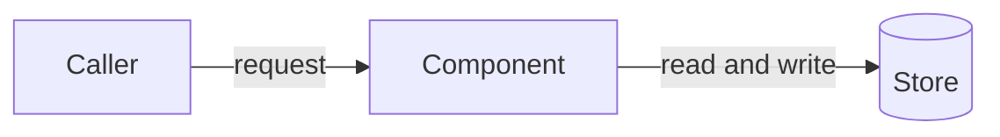

# Repository docs

Where each kind of documentation lives in a project, and how to write the docs in a code repository: its `docs/` folder, `README.md`, `CLAUDE.md` and `CONTRIBUTING.md`. **Load before you write or change any of them, or decide where a doc belongs.** Source means the project's code repository. These are house defaults, such as user docs in the wiki: where a project's `CLAUDE.md` says otherwise, follow the project.

## Where docs go

| Doc | Lives in | For | Holds |
| --- | --- | --- | --- |
| User docs | The project's GitHub wiki | People who use the project | Installing, configuring, using and troubleshooting it. Load the wow-github-wiki skill |
| `README.md` | Source's root | Users first, then engineers | A pointer to the wiki, then the engineering entry point |
| Design docs | Source's `docs/` | Engineers who change the code | Low-level design and implementation |
| `CONTRIBUTING.md` | Source's root | Contributors | Reporting a problem, proposing a change, building, testing and what CI runs |
| `CLAUDE.md` | Source's root | Claude agents | The index: layout, conventions and which design doc to read before changing each part |
| Code comments | The code | Engineers reading that code | What one function, type or package doesn't make obvious |

- Put each fact in one of these, and link to it from the others.
- Never put user docs in `docs/`, or design, build or test docs in the wiki. `docs/` is never a copy of the wiki.
- Shared practices, such as commit messages and branching, live in the ways of working (the `wow-*` skills), not in a project's docs. `CONTRIBUTING.md` summarises them for external contributors.
- If the project has no wiki, ask the user where user docs go before you write any.

## Design docs

### What a design doc covers

A design doc explains how one component, package or cross-cutting concern works, so an engineer can change it safely. Cover what applies:

- **Responsibilities:** what it does and doesn't do, and where it sits among the other parts.
- **How it works:** data flow, control flow, protocols, state and concurrency.
- **Interfaces:** what it offers and expects, including types, errors and invariants.
- **Errors and logging:** how it fails, and what's safe to show, log or send.
- **Security and privacy:** trust boundaries, secrets and what never leaves the process.
- **Decisions:** the choices made, the alternatives rejected and why.
- **Limits:** known gaps and what it deliberately doesn't handle.

Every design doc has at least one Mermaid diagram of the structure or flow it describes. Load the wow-diagrams skill and follow it, including validating each diagram.

- Link to the code with relative paths, such as `[store.go](../internal/store/store.go)`, and put identifiers in code spans.
- Quote short excerpts of code only. Long excerpts drift from the code they copy.
- Don't repeat what a function's doc comment already says. Link to the file.

### Keep docs in step with the code

- `docs/` is versioned with the code, so a doc describes the code on the same branch. Update it in the same PR as the code change that makes it out of date. Reviewers check that it's been updated.
- Describe anything not built yet as planned. A doc for a proposed design says so in its intro.
- A docs-only change doesn't bump the version (load the wow-versioning skill).

### Files and names

- Cover one topic per file. Name it after the topic, in lowercase with hyphens, such as `docs/error-handling.md`.
- Start flat. When several docs cover one area, move them into a subfolder with an `overview.md` that links to the rest.
- Put images that aren't diagrams, such as screenshots, in `docs/images/`.
- Write in the house style and GitHub Flavored Markdown (load the wow-writing-style and wow-markdown skills). Keep each doc under 200 lines. Split a longer one by topic.

### Shape of a design doc

````markdown
# <Topic>

<What this doc covers and who it's for, in one or two sentences.>

## Contents

1. [Overview](#overview)
1. [How it works](#how-it-works)
1. [Decisions](#decisions)

## Overview

<Responsibilities, and where it sits:>



## How it works

## Decisions
````

Use the sections that apply, from the list in [What a design doc covers](#what-a-design-doc-covers). End with `## Sources` when the doc relies on outside documentation.

## Contents lists

Every doc in `docs/`, and every `CLAUDE.md`, in a code repository has a `## Contents` list straight after its intro, whatever its length. This overrides the 200-line threshold in the wow-writing-style skill.

- List each `##` section in order, as a `1.` item that links to its anchor: `1. [How it works](#how-it-works)`.
- Don't list `## Contents` itself.
- Update the list whenever you add, rename or remove a section.

## README.md

1. A `#` title, and a one-line summary of what the project is.
1. **If the project has a wiki:** a short section for users, straight after the summary. Say what the project does for them, and link to the wiki and its main pages with absolute URLs, such as `https://github.com/OWNER/REPO/wiki/Installation`. Installation and usage steps live in the wiki, not here.
1. **The rest is for engineers:** what the code is and how it's built at a high level, with an architecture diagram, and links to each design doc in `docs/`, to `CONTRIBUTING.md` and to the licence.

Don't copy `CLAUDE.md`'s layout map into the README. Describe the parts at the level of the architecture, and link to the design docs for the detail.

## CLAUDE.md

1. A `#` title: the project's name.
1. One or two sentences that say what the code is.
1. `## Contents`, as [Contents lists](#contents-lists) describes.
1. `## Layout`: each folder or package, what it holds, and the design doc to read before you change it, written as a trigger, such as `` Before you change `internal/store/`, read [docs/store.md](docs/store.md). ``
1. `## Conventions`: rules for the code that an agent must follow, such as where tests go or which dependencies are allowed. Link to `CONTRIBUTING.md` for build and test commands rather than copying them.
1. `## Ways of working`: the optional project profile. Copy it from [references/project-profile.md](references/project-profile.md).

`CLAUDE.md` holds no design of its own. It points to `docs/`.

## CONTRIBUTING.md

- It's written for external contributors, and it's where the project documents how to build and test the code and what CI runs. Internal contributors use those facts too, though it ranks last for internal work (the wow-core rule sets which guidance wins).
- Cover reporting a problem, proposing a change, building, testing (including tests that need a special environment), CI, and a summary of the commit, branch and PR rules.
- Link to `docs/` for design. Don't explain the design in `CONTRIBUTING.md`.

## Checklist

Before you finish a change to a code repository's docs, check that:

- Each fact is in the right place from [Where docs go](#where-docs-go), and nowhere else.
- Every design doc has a linked Contents list and at least one validated Mermaid diagram.
- The docs match the code on the branch, and anything planned is described as planned.
- The README sends users to the wiki first, if there is one.
- `CLAUDE.md`'s Layout names the design doc for every part that has one.
